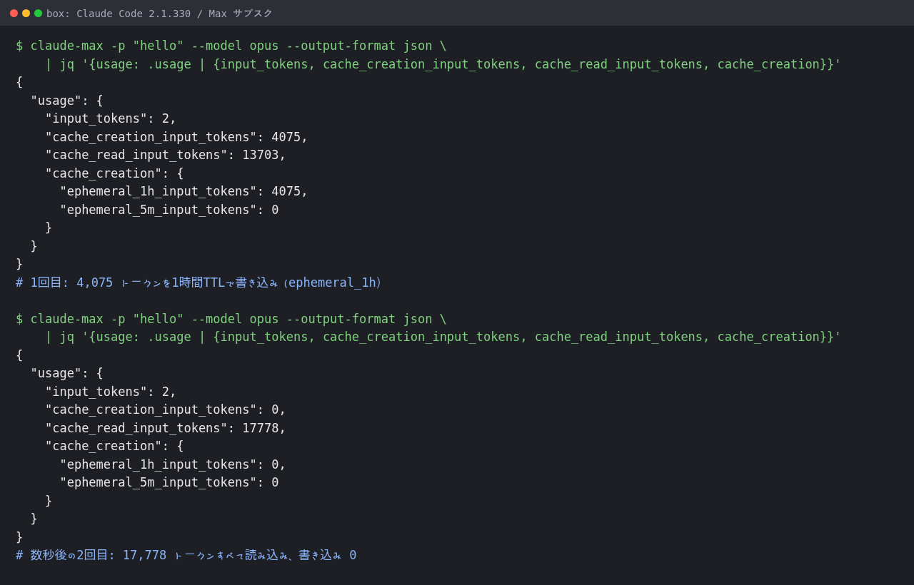
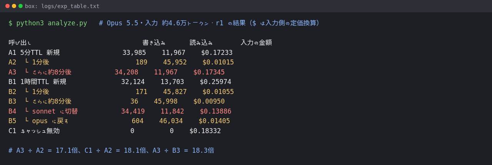
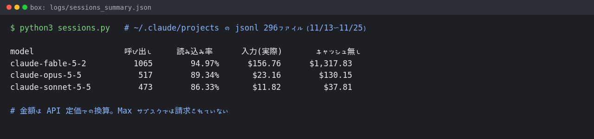

Xで「必要な額の20倍を Claude に払っている」というポストを見かけ、Claude Code（Maxサブスク、主に Opus 5.5）を18回呼んで確かめました。
キャッシュが効いた回と比べて、切れた回の入力は定価換算で16〜18倍。意外だったのは、僕の環境は既定のTTL（キャッシュが残る時間）が1時間で、約8分休んでも切れなかったことです。
自分のTTLを見るコマンドと、ログから読み込み率を出すワンライナーを置いておきます。検証用マシンのログ 2,055件を数えたら、86〜95%はもう読み込みでした。

こんにちは、八兵衛です。

:::message
金額はすべて「APIの定価で換算した値」です。僕は Max サブスクで使っているので、実際には請求されていません。サブスクの利用上限の減り方が定価換算と同じ比率かどうかは、確かめていません。
:::

## 元のポスト

https://x.com/L1vsun/status/2123433474157637742

@L1vsun さんのポストです（2026-11-20 00:09 JST）。原文はこうです。

> you're paying Claude 20x more than you f\*cking need to
> same model. same words. $4 per million tokens or $0.20
> the only difference is whether the start of your request changed
> every turn re-sends everything. system prompt, `CLAUDE.md`, every message, every tool result

> （訳）必要な額の20倍を Claude に払っている。
> 同じモデル、同じ言葉。百万トークンあたり $4 か、$0.20 か。
> 違いは、リクエストの先頭が変わったかどうかだけ。
> 毎ターン、全部を送り直している。システムプロンプト、`CLAUDE.md`、すべてのメッセージ、すべてのツール結果。

原文に「キャッシュ」の語もモデル名もありません。タイトルの「キャッシュ切れで20倍」は、$4 と $0.20 から僕がそう読んだ要約です。

APIで取れた本文は、このあとの「turn 40」まで。続きの動画とリンクは確認できていません。

## 「20倍」は何と何の比？

キャッシュは、屋台の保冷箱みたいなものだと思ってください。氷があるうちは、箱から出すだけで安い。これが「読み込み」で、箱を使わないときの値段が「通常入力」です。氷がもつ時間が TTL で、5分か1時間。

ポストの $4 と $0.20 は、Opus 5.5 の通常入力と読み込みの単価と同じでした。[API公式の料金表](https://platform.claude.com/docs/en/build-with-claude/prompt-caching)（2026-11-25 取得。単位はドル/MTok、MTok は百万トークン）から並べます。

| モデル | 通常入力 | キャッシュ読み込み | 倍率 |
| --- | --- | --- | --- |
| Opus 5.5 | $4 | $0.20 | 20倍 |
| Sonnet 5.5 | $2 | $0.10 | 20倍 |
| Fable 5.2 | $8 | $0.20 | 40倍 |
| Opus 4.8 | $5 | $0.50 | 10倍 |
| Sonnet 4.6 | $3 | $0.30 | 10倍 |

単価の話としては、20倍は本当でした！ ただしモデルによって10倍にも40倍にもなります。

でも待ってください。切れたあとにかかるのは、本当に「通常入力」の単価でしょうか？

Claude Code は、切れたぶんをキャッシュに書き込み直すことが多いです。書き込みの単価は、5分TTLなら通常入力の1.25倍、1時間TTLなら2倍。Opus 5.5 だと $5 と $8 で、読み込みの $0.20 から見ると25倍と40倍です。

氷が溶けたら全部仕入れ直しで、氷代まで乗ってきます。じゃあ定価換算だと何倍になるのか。測りました。

## まず hello を2回呼んで、自分のTTLを見る

[Claude Code 公式](https://code.claude.com/docs/en/prompt-caching)に載っている確かめ方に、jq を足しただけです。

```bash
claude -p "hello" --output-format json | jq '.usage'
```


*1回目は 4,075 トークンを1時間TTLで書き込み。数秒後の2回目は 17,778 トークンが全部読み込み*

`cache_creation` の `ephemeral_1h_input_tokens` に数字が入れば1時間TTL、`ephemeral_5m_input_tokens` なら5分TTLです。僕の環境は1時間でした。2回目のように書き込みがない回は両方0なので、書き込みのあった回で見てください。

動かしたのは検証用の Linux マシン（以下 box）です。画像の `claude-max` は Max 用のラッパーで、中身は同じ Claude Code 2.1.330。画像では `--model opus` を付け、jq で項目を絞っています。

画像は3枚とも box のログを整形した表示で、`#` の行は僕の注記です。アカウント情報や会話の本文は入れていません。

## 実験：5分TTL・1時間TTL・キャッシュ無効を並べる

- 環境: box（Linux x86_64）、Claude Code 2.1.330、Max サブスクでログイン（APIキーではない）
- モデル: claude-opus-5-5。切り替え先は claude-sonnet-5-5
- 実施: 2026-11-25 13:12〜13:23 JST
- 入力: 公式ドキュメント2本の本文 約79,000文字＋質問。1回目の入力合計は 45,829〜45,954 トークン。2回目以降は `--resume` で同じセッションに一言の質問を足す
- A: `FORCE_PROMPT_CACHING_5M=1`（5分TTLを強制）で、新規 → 1分後 → その約8分後
- B: 既定のまま同じ間隔で呼び、直後に sonnet へ切り替え → opus に戻す。切り替えは `--resume` に `--model sonnet` を付ける形で、対話中の `/model` は試していません
- C: `DISABLE_PROMPT_CACHING=1`（キャッシュ無効）で、新規の1回だけ
- 回数: この9種類を2回ずつ（r1・r2）で18回

金額は、各回の usage に公式単価を掛けた入力側だけの値です（出力は5〜183トークン、$0.0001〜$0.004）。

## 結果：切れると16〜18倍。でも約8分では切れない


*r1 の結果（ログを整形した表示）。赤い行（A3・B4）がキャッシュの切れた呼び出し*

2回ぶんを並べます（r1 / r2）。通常入力は、キャッシュ無効の回（C1）が 45,829 トークン、ほかは2〜4トークンでした。

| 呼び出し | 書き込み | 読み込み | 入力の金額 |
| --- | --- | --- | --- |
| A1 5分TTL・新規 | 33,985 / 32,124 | 11,967 / 13,828 | $0.17233 / $0.16339 |
| A2 1分後 | 189 / 179 | 45,952 / 45,952 | $0.01015 / $0.01010 |
| A3 その約8分後 | 34,208 / 32,341 | 11,967 / 13,828 | $0.17345 / $0.16449 |
| B1 既定（1時間TTL）・新規 | 32,124 / 32,124 | 13,703 / 13,703 | $0.25974 / $0.25974 |
| B2 1分後 | 171 / 210 | 45,827 / 45,827 | $0.01055 / $0.01086 |
| B3 その約8分後 | 36 / 36 | 45,998 / 46,037 | $0.00950 / $0.00951 |
| B4 直後に sonnet へ切替 | 34,419 / 32,616 | 11,842 / 13,703 | $0.13886 / $0.13184 |
| B5 直後に opus に戻す | 604 / 604 | 46,034 / 46,073 | $0.01405 / $0.01405 |
| C1 キャッシュ無効 | 0 | 0 | $0.18332 / $0.18332 |

**切れると16〜18倍でした。**

- キャッシュ無効の回（C1）÷ 読み込めた回（A2）: 18.1倍、18.2倍
- 5分TTLで切れた回（A3）÷ 切れる前（A2）: 17.1倍、16.3倍
- 切れた回（A3）÷ 1時間TTLで同じだけ待った回（B3）: 18.3倍、17.3倍

単価比（20倍、書き込み直しなら25倍）に届かない理由は、2つあります。

1つめ。読み込めた回（A2）でも、新しく足した部分（質問と前回の応答）は書き込み単価、入力の4トークンは通常単価です。

2つめ。5分TTLで切れた回（A3）は、全部が切れた回ではありません。書き込み直したのは 34,208／32,341 トークン（単価は通常入力の1.25倍）で、11,967／13,828 トークンは読み込みのままでした。

**約8分休んでも、既定のままなら切れませんでした。**

既定のまま約8分空けた回（B3）の書き込みは、36トークンだけ。同じ時間を空けた5分TTLの回（A3）は、上のとおり書き込み直しです。Claude のサブスク（僕は Max）で利用枠内なら、メイン会話は既定で1時間TTLだからです（Claude Code 公式）。コーヒーを淹れて戻るくらいの時間では、氷は溶けない。ここはマジで意外でした！

**モデルを切り替えると、即切れました。**

sonnet に切り替えた回（B4）は、直前の回（B3）の14.6倍、13.9倍。Sonnet の単価は Opus の半分なのに、です。opus に戻した回（B5）は、46,034／46,073 トークンが読み込みに戻りました。モデルを行き来する使い方だと、定価換算ではここが一番響きそうです。

**1時間TTLは、最初の1回がむしろ高い。**

1時間TTLの新規の回（B1）は、キャッシュ無効の回（C1）の1.42倍でした。書き込みが通常入力の2倍だからです。キャッシュしたのに高い、という回です笑 5分TTLの新規の回（A1）は0.94倍、0.89倍。1回呼んで終わりの使い方なら、定価換算では1時間TTLは安くなりません。

もう1つ。キャッシュが無いはずの新規の回（A1・B1）、切り替えた回（B4）、5分TTLで切れた回（A3）でも、11,842〜13,828 トークンは読み込みでした。システムプロンプトとツール定義の先頭が、同じアカウントの直前の利用で温まっていたのだと考えていますが、これは推測です。

## box のログも数えたら、もうほとんど読み込みだった

実験は短い会話です。じゃあ、ふだんはどうなのか。この box で約12日動いていた Claude Code（記事作業などの自動実行）のログも数えました。

`~/.claude/projects` の jsonl 296ファイルを読み、この記事の作業フォルダで動いたぶんを除いた API呼び出し 2,055件です（2026-11-13 09:56〜2026-11-25 13:13 JST。requestId で重複を除去）。


*モデル別の読み込み率と入力側の定価換算（ログを整形した表示）。「入力(実際)」の列も請求額ではなく定価換算*

読み込み率は、入力全体に占める読み込みの割合です。

- Fable 5.2: 1,065回、読み込み率 94.97%。入力側 $156.76、キャッシュなしなら $1,317.83（8.4倍）
- Opus 5.5: 517回、89.34%。$23.16、キャッシュなしなら $130.15
- Sonnet 5.5: 473回、86.33%。$11.82、キャッシュなしなら $37.81

8.4倍は入力側だけの定価換算です。何も設定しなくても Claude Code がキャッシュを効かせていて、僕の環境はいつも20倍の状態ではありませんでした。元ポストを読んだときの印象と一番違ったのは、ここです。

ただ、これは自動実行が中心のログです。人が対話で使う場合は確かめていません。

一方で「2万トークン以上の入力なのに、読み込みが半分未満」の呼び出しも、Fable 34回・Opus 43回・Sonnet 25回ありました。原因までは追えていません。

自分のログで同じ率を出すワンライナーです。

```bash
# ~/.claude/projects のログから、モデル別のキャッシュ読み込み率を出す（本文は読まない）
cat ~/.claude/projects/*/*.jsonl \
| jq -r 'select(.type=="assistant" and .message.usage and .message.model!="<synthetic>")
         | [.requestId, .message.model, .message.usage.input_tokens,
            .message.usage.cache_creation_input_tokens, .message.usage.cache_read_input_tokens] | @tsv' \
| sort -u -k1,1 \
| awk -F'\t' '{i[$2]+=$3; w[$2]+=$4; r[$2]+=$5; n[$2]++}
   END {for (m in n) printf "%-20s 呼び出し %5d  読み込み率 %.1f%%\n", m, n[m], 100*r[m]/(i[m]+w[m]+r[m])}'
```

## つまずいたこと

- **total_cost_usd を1回ぶんだと勘違いしかけた。** `--resume` するとセッション累計になります。r1 の A2 は $0.18582 と出ましたが、1回ぶんは出力込みで $0.01025。A1 の $0.17557（出力込み）が乗っていました笑
- **sonnet の回を opus と数えていた。** `modelUsage` の先頭キーで判定していたのが原因で、`canonicalModel` のある方に直しました。
- **ワンライナーと集計で件数が合わない。** ワンライナーは Fable 946・Opus 527・Sonnet 475。各プロジェクト直下の jsonl だけを読み（subagents などのサブフォルダは読まない）、今回の実験も含むからです。

## 使えない場面

この記事の数字が、そのまま当てはまらない場面です。

- **APIキーで使う場合。** 既定はメイン会話も5分TTLです。サブスクでも、利用枠を超えて usage credits（利用枠とは別のクレジット）を使い始めると5分に下がります（公式）。
- **メイン会話以外。** サブエージェントなどは、サブスクでも5分TTLです（公式）。box のログでも、Opus 5.5 の書き込みはすべて5分TTLで、Fable 5.2 も 8,279,342 トークン中 1,169,374 が5分でした。内訳は確かめていません。
- **全部が切れた場合。** 5分TTLで切れた回も、一部は読み込みのままでした。全部を書き込み直す場合は測っていません。
- **1時間を超えて空けた場合。** 試していません。
- **ほかのモデルや経路。** 測ったのは Opus 5.5 と切り替え先の Sonnet 5.5 だけです。Bedrock やゲートウェイ経由も測っていません。
- **長い会話。** 元ポストの本文は「turn 40」で切れていて、その先は未確認です。数十ターンの会話は試していません。2回の実験も、ほぼ同じ時刻に走らせたものです。

## 公式の「切れる操作」チェックリスト

[Claude Code 公式](https://code.claude.com/docs/en/prompt-caching)が挙げる、キャッシュが切れうる操作です。条件によって切れないものもあるので、詳しくは公式を見てください。

- **試した**: モデル切り替え（`--resume` に `--model` を付ける形。即切れた）
- **試していない**: effort 変更（公式では、Opus 5.5・Sonnet 5.5 などはサブスク／APIキーなら既定で維持）、fast mode をオン、MCPサーバーの接続・削除、プラグインの有効化・無効化、ツールを丸ごと拒否、/compact、画像の蓄積、Claude Code の更新

## まとめ

「20倍」は単価としては本当で、僕の手元では、切れた回がキャッシュの効いた回の16〜18倍（定価換算）でした。でも既定の1時間TTLは約8分では切れず、box のログは86〜95%がもう読み込み。僕の環境は、いつも20倍の状態ではありませんでした。

やることは3つです。

1. hello を2回呼んで、usage で TTL と読み書きを見る
2. ワンライナーで、自分のログの読み込み率を出す
3. モデルは最初に決める。ほかの操作も、やる前にチェックリストを見る

5分TTLと比べたい人だけ、`FORCE_PROMPT_CACHING_5M=1` をコマンドの頭に付けて試してください（実験の A です）。試したら外します。

Max の保冷箱の氷は、約8分では溶けませんでした。

みなさんの氷は5分ですか、1時間ですか？ まずは hello を2回、呼んでみてください！
