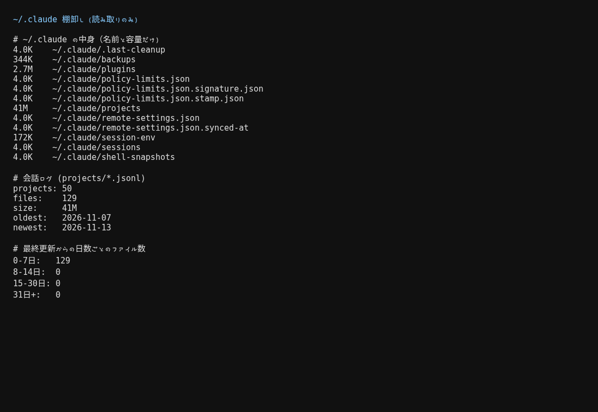
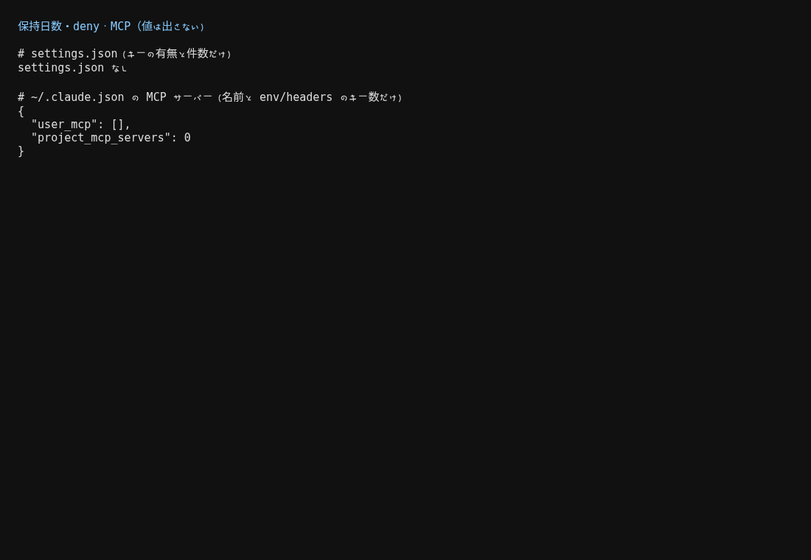
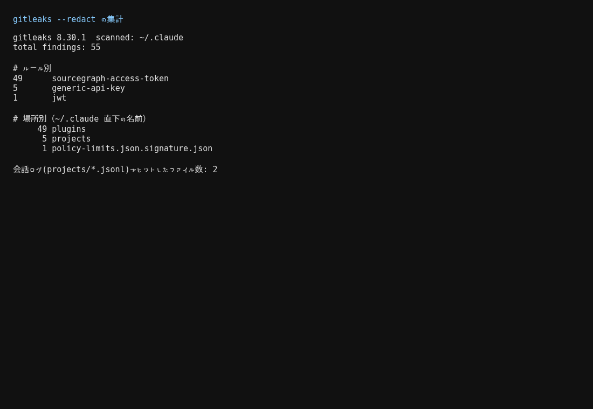
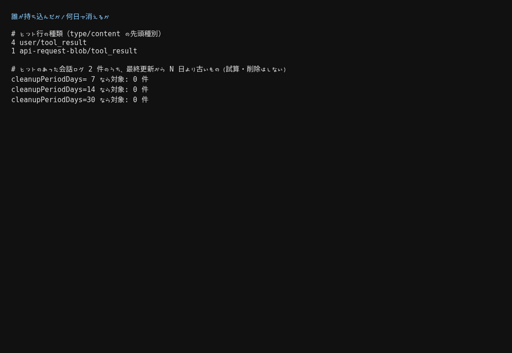

Claude Code の `~/.claude` を読み取りだけで棚卸しして gitleaks をかけたら、ヒットは55件でした！
ただし49件はプラグインのキャッシュ（`plugins`）で、会話ログでのヒットは5件・2ファイルだけ。しかも5件ともツールの実行結果で、僕が打ったテキストとしてのヒットは0件でした。
点検の手順とチェックリストを置きます。

趣味でSEをやっている hatyibei です。
## 1. 55件の内訳と、なぜ点検したか

| 場所（`~/.claude` 直下） | 件数 | gitleaks のルール |
|---|---|---|
| `plugins`（`plugin-directory-cache-v2.json` 1ファイル） | 49 | sourcegraph-access-token |
| `projects`（会話ログ jsonl 2ファイル） | 5 | generic-api-key |
| `policy-limits.json.signature.json` | 1 | jwt |
| 合計 | 55 | |

gitleaks は、ファイルの中から「API キーやトークンっぽい文字列」を探す無料の OSS です。
**これは gitleaks の既定ルールへのヒット件数です。** 値は見ていないので、本物の有効な鍵かどうかは確かめていません。失効の操作もしていません。

Claude Code を使っていると、`.env` を読ませたり、`curl` の結果を見せたりしますよね？
そのやり取りはローカルの会話ログ（`~/.claude/projects/*.jsonl`。1行に1件の JSON が並ぶファイル）に残ります。
「今どれくらい溜まってて、何が混ざってるの？」が気になって、一度数えてみました。

条件です（2026年11月13日 17:16 JST に実施）。

- Claude Code 2.1.319 / gitleaks 8.30.1（GitHub Releases の linux_x64、checksum 一致を確認）/ python 3.13.5
- 対象は box（僕の作業用の Linux マシン）の `~/.claude`（`CLAUDE_CONFIG_DIR` は未設定）
- **読み取りのみ**。削除・設定変更・push はしていません
- 所要時間は約53秒（失敗した集計を含む。スキャン自体は1秒）、API 費用は $0

## 2. 棚卸し：会話ログは129ファイル・41MB

まずは名前と容量だけ見ました。



- `~/.claude/projects` が 41M で、ほぼこれが全部
- 会話ログはプロジェクトディレクトリ 50、jsonl ファイル 129
- 最終更新は 2026-11-07〜2026-11-13。8日以上前のものは0件

つまりこの box の会話ログは、**全部が、検証した11/13から7日以内**でした。
jsonl だけで1週間分41MB。思っていたより溜まってます！

## 3. 設定：settings.json がそもそも無かった

次に、`cleanupPeriodDays`（古い会話ログを何日で消すかの設定）と `permissions.deny`（Claude に触らせないファイルやコマンドを決める設定）、MCP サーバーの env キー数を見ました。値は出さず、有無と件数だけです。



- `~/.claude/settings.json` が**無かった**ので、`cleanupPeriodDays` も `permissions.deny` も未設定
- `~/.claude.json` のユーザー MCP サーバーは0、プロジェクト MCP サーバーも0

未設定のときの `cleanupPeriodDays` の既定値は、今回は公式ページから確定できていないので**未確認**です。

## 4. gitleaks：55件、ただし会話ログは2ファイル

gitleaks を `--redact`（値を伏せて出力するオプション）付きで `~/.claude` 全体にかけました。
レポートには RuleID / Entropy / StartLine / File だけを残し、Secret と Match は保存していません。元のレポートはその場で消しています。



「55」という数字だけを見ると、けっこう多く見えます。
でも場所別に分けると、49件はプラグイン一覧のキャッシュ1ファイルに集中していました。jwt の1件も含めて、値を見ていないので何なのかは判断していません。
同じように大きな数字が出たら、まず場所別に分けて見るのがおすすめです。

## 5. 誰が持ち込んだか：5件とも tool_result

会話ログでヒットした行は、中身を見ずに `type` ラベルだけを数えました。



| ヒット行の種類 | 件数 |
|---|---|
| `user/tool_result` | 4 |
| `api-request-blob/tool_result` | 1 |
| `user/text`（自分が打ったテキスト） | 0 |

tool_result は、Claude がツールを実行した結果として受け取った出力です。
5件すべてが tool_result として残っていて、`user/text` としてのヒットは0件でした。どのツールの出力かまでは数えていません。

これはけっこう大事なポイントだと思っています。
この box では、「秘密をチャットに貼らない」だけでは、ログに残るものを全部は押さえられない、というのが数字で見えました。

## 6. 保持日数を縮めたら消える？→今回は0件

`cleanupPeriodDays` を7・14・30日にした場合を試算しました（削除はしていません）。どれでも対象は**0件**です。
ヒットのあった2ファイルは、どちらも最終更新が7日より新しいからです。
保持日数は「古いログを溜めない」対策です。この box のヒットは新しすぎて、今回はどの日数でも対象外でした。

## 7. 手元で試す手順

ここからは**全部読み取りのみで、何も消しません**（gitleaks の一時レポートだけは自分で作って自分で消します）。
必要なのは `gh`（GitHub CLI、ログイン済み）、`curl`、`jq` です。
5節の表（ヒット行の種類）は jsonl の該当行を開く処理なので載せていません。この手順だけでは5節は再現できない点はご了承ください。

### 7-0. 準備

```bash
set -euo pipefail   # run.sh のようにファイルに保存して実行する（端末に直接貼ると、エラーのたびにシェルが終了します）
umask 077                     # 作るファイルを自分だけが読めるようにする
CDIR=${CLAUDE_CONFIG_DIR:-$HOME/.claude}
LOG=$PWD/logs                 # 集計結果の置き場
TOOLS=$PWD/tools              # gitleaks の置き場
mkdir -p "$LOG" "$TOOLS"
```

### 7-1. gitleaks を公式リリースから入れる（checksum 確認つき）

最新版のタグを取るので、僕の検証時（8.30.1）と版が違うと件数も変わることがあります。

```bash
TAG=$(gh release view -R gitleaks/gitleaks --json tagName -q .tagName)
VER=${TAG#v}
TGZ=gitleaks_${VER}_linux_x64.tar.gz
SUM=gitleaks_${VER}_checksums.txt
( cd "$TOOLS"
  curl -fsSLO "https://github.com/gitleaks/gitleaks/releases/download/${TAG}/${TGZ}"
  curl -fsSLO "https://github.com/gitleaks/gitleaks/releases/download/${TAG}/${SUM}"
  grep " ${TGZ}\$" "$SUM" | sha256sum -c -
  tar -xzf "$TGZ" gitleaks )
```

### 7-2. 棚卸し（名前・容量・日付・件数だけ）

```bash
du -sh "$CDIR"/* "$CDIR"/.[!.]* 2>/dev/null | sed "s#$HOME#~#" | sort -k2
find "$CDIR/projects" -type f -name '*.jsonl' | wc -l
find "$CDIR/projects" -type f -name '*.jsonl' -mtime -8 | wc -l   # 最終更新0-7日
find "$CDIR/projects" -type f -name '*.jsonl' -mtime +7 | wc -l   # 8日以上
```

### 7-3. 設定は「有無と件数」だけ見る

settings.json が無い環境（僕の box と同じ）でも止まりません。

```bash
[ -f "$CDIR/settings.json" ] && jq '{cleanupPeriodDays: (.cleanupPeriodDays // "未設定(既定値)"),
     deny_rules: ((.permissions.deny // []) | length),
     deny_rules_env: ([(.permissions.deny // [])[] | select(test("env"))] | length)}' \
  "$CDIR/settings.json" || echo "settings.json なし"

[ -f ~/.claude.json ] && jq '{user_mcp: [(.mcpServers // {}) | to_entries[]
     | {name: .key, env_keys: ((.value.env // {}) | length)}]}' ~/.claude.json \
  || echo "~/.claude.json なし"
```

MCP の env は**キーの数だけ**。値は出しません。

### 7-4. `--redact` でスキャンし、レポートから値を落とす

ここがいちばん大事です！

```bash
RAW=$(mktemp "$LOG/.raw.XXXXXX.json")
trap 'rm -f "$RAW"' EXIT
"$TOOLS/gitleaks" dir "$CDIR" --redact --no-banner --log-level warn --exit-code 0 \
  --report-format json --report-path "$RAW"
jq --arg c "$CDIR/" '[.[] | {RuleID, Entropy, StartLine, File: (.File | ltrimstr($c))}]' "$RAW" \
  > "$LOG/04_findings_redacted.json"
rm -f "$RAW"
```

件数を数えるのに必要なのは RuleID と File と行番号だけなので、それ以外は保存前に落としています。

### 7-5. 集計（ルール別・場所別）

```bash
F=$LOG/04_findings_redacted.json
jq -r 'group_by(.RuleID)[] | "\(length)\t\(.[0].RuleID)"' "$F" | sort -rn
jq -r '.[] | .File | split("/")[0]' "$F" | sort | uniq -c | sort -rn
jq '[.[] | select(.File | test("^projects/.*\\.jsonl$")) | .File] | unique | length' "$F"
```

`type` ラベルの集計を自分で書く場合は、ラベル以外を絶対に出力しない作りにしてください。
スクショは値も個人情報も出さない作りで撮り、撮影後に目視でも確認しています。会話ログのパスにはプロジェクト名が入るので、画面にも本文にも出していません。

## 8. チェックリスト

カッコ内は僕の box の結果です。

- [ ] `cleanupPeriodDays` を設定しているか（settings.json なし＝未設定）
- [ ] `permissions.deny` に `.env` を含むルールがあるか（0）
- [ ] MCP サーバーの env キー数はいくつか（サーバー0）
- [ ] gitleaks のヒット内訳（全体55：plugins 49 / 会話ログ 5・2ファイル / jwt 1）
- [ ] 保持日数を縮めたら何件が対象になるか（7・14・30日のどれでも0件）

## 9. つまずいたこと

スキャン自体は一発で通りました（55件）。こけたのは集計です。

**① `python3 -c` のエスケープで構文エラー**
最初の run.sh では、集計用の Python を `python3 -c '...'` の単一引用符の中に書いていました。
そこで `o.get(\"type\")` のエスケープがそのまま構文エラーに。単一引用符の中ではバックスラッシュが効かないのを、完全に忘れてました笑

**② heredoc と jq のパイプが stdin を取り合った**
直しの1回目で、Python のプログラムを heredoc で渡しつつ、jq の結果も同じ stdin に流しました。
jq が SIGPIPE で落ちて、種別集計が空になりました。

**③ スクリプトを別ファイルに分けて解決**
`tools/origin_count.py` と `tools/retention.py` に分け、jq の出力だけを stdin に流す形で通りました。run.sh もこの形に直してあります。
集計の Python は、最初からファイルに分けておくのが正解でした。

## 10. 使えない場面

- **鍵が本物かどうかは分かりません。** 値を見ていないので、有効な鍵なのか、鍵っぽい別の文字列なのかは判断していません。
- **既定ルールに合わないものは数えていません。** ルールを追加していないので、引っかからない形の秘密は数に入っていません。
- **読み取り専用の点検です。** 分かるのは「今どうなっているか」までで、点検しただけで安全になるわけではありません。

## まとめ

会話ログのヒットは5件・2ファイルで、全部 tool_result。保持日数を縮めても対象外でした。
持ち帰りは、「ツールの実行結果もログに残る」です。

僕の box では約53秒でした。設定を見直すついでに、自分の `~/.claude` も数えてみてください！
