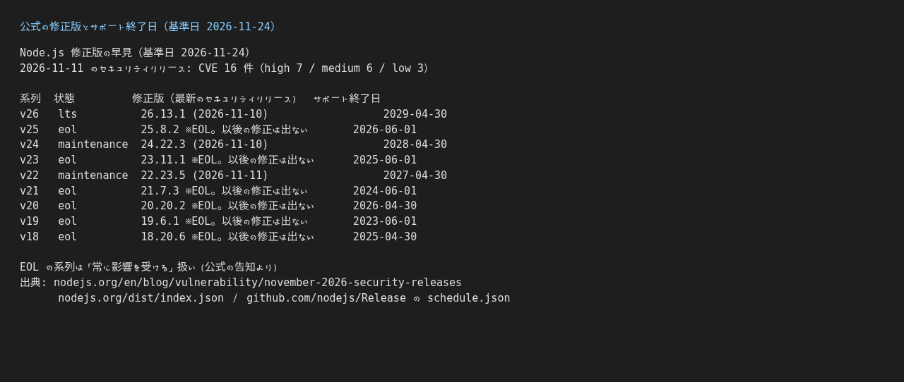
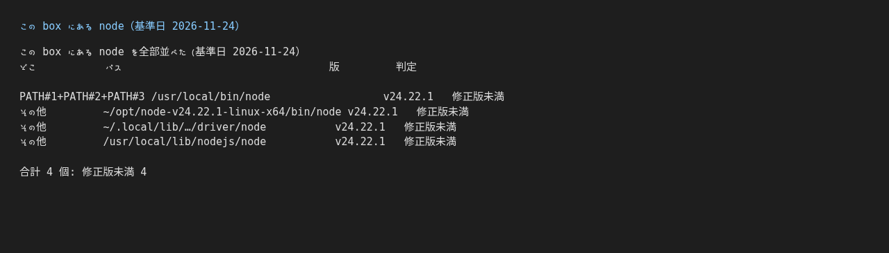
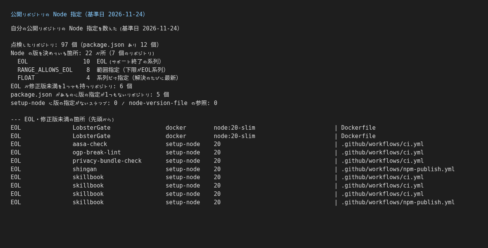
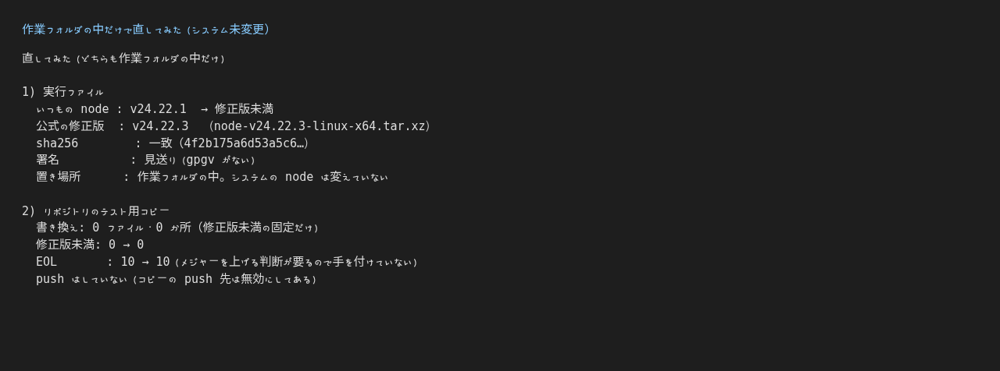

自分の公開リポジトリ97個で「Node の版を決めている箇所」を数えたら、指定があったのは7個・22か所で、うち10か所がサポート終了（EOL）の系列でした（系列は、v24 のような版の先頭の数字）。
意外だったのは、修正版より前の版に固定している箇所が0か所だったことです。ただ、22か所はすべて系列か範囲の指定で、x.y.z まで書いた固定は1つもありません。修正版未満だったのは、検証機で見つけた `node`（4個とも v24.22.1）のほうでした！
この記事からは、`node -v` と修正版の見比べ方、`engines` / `setup-node` / Dockerfile の版指定の探し方、チェックリストを持ち帰れます。

こんにちは、八兵衛です。

2026-11-11 の Node.js セキュリティリリースが出ていたので、「で、僕の手元はどうなの？」を数えてみました。
やったのは棚卸しです。引き出しを全部開けて、ラベル（版番号）を読んで、分けるだけ。攻撃の再現や、他人のシステムへの操作はしていません。

:::message
**検証の条件**

- 日時: 2026-11-24 20:37:00〜20:38:25 JST に2回実行（1回目 20秒、2回目 28秒）。記事の数字は2回目です
- 環境: Debian GNU/Linux 13 (trixie)
- 対象: 検証機の `node` と、自分の公開リポジトリ（fork と archived は除外）
- 書き込みは作業フォルダの中だけ。GitHub への書き込み・push はなし。API 費用は $0
- スクショはログを画像にしたもの。ホームは `~`、アカウント名は `<owner>` に置き換えています。スクショの box は検証機のことです
:::

## 0. 前提は短く

Node.js の公式ブログ（見出し日 2026-11-11）のセキュリティリリースで、修正対象の一覧に載っている CVE は16件（high 7 / medium 6 / low 3）です。修正版は 22.23.5 / 24.22.3 / 26.13.1。
ブログには "End-of-Life versions are always affected when a security release occurs." とあります。公式は EOL の系列を、毎回「影響を受ける」扱いにしています。

https://nodejs.org/en/blog/vulnerability/november-2026-security-releases

## 1. 比べる基準を先に作る

公式の [index.json](https://nodejs.org/dist/index.json) から `security: true` の最新を系列ごとに引き、[schedule.json](https://raw.githubusercontent.com/nodejs/Release/main/schedule.json) のサポート終了日と並べました。基準日は 2026-11-24 です。



| 系列 | 修正版 | index.json の日付 | サポート終了日 |
| --- | --- | --- | --- |
| v26 | 26.13.1 | 2026-11-10 | 2029-04-30 |
| v24 | 24.22.3 | 2026-11-10 | 2028-04-30 |
| v22 | 22.23.5 | 2026-11-11 | 2027-04-30 |
| v20 | EOL。公式の修正は出ない | — | 2026-04-30 |

表にない v18 と v25 も EOL です（サポート終了日は 2025-04-30 と 2026-06-01）。

ブログに書いてある修正版と index.json の値は、v22 / v24 / v26 とも一致しました。
日付は出典で違います。ブログの見出し日は 2026-11-11 ですが、index.json では 24.22.3 と 26.13.1 が 2026-11-10、22.23.5 だけが 2026-11-11 でした。

## 2. まず `node -v`。検証機は4個とも修正版未満でした

みなさんの `node -v`、最後に見たのはいつですか？ ここは今すぐ試せます！

```bash
node -v
type -aP node
```

出てきた版の先頭の数字で上の表の行を選び、修正版より前かどうかを見るだけです。
僕の検証機は v24.22.1。v24 の修正版は 24.22.3 なので、修正版未満でした。

`type -aP node`（bash の書き方）は3つ返しましたが、`/usr/bin/node` と `/bin/node` は `/usr/local/bin/node` へのシンボリックリンクで、実体は同じです。
じゃあ1個見れば済むか？ 済みませんでした。PATH の外にも `node` がいます。



探した範囲では、実体で重複を除くと4個で、ぜんぶ v24.22.1 でした。

- `/usr/local/bin/node`（PATH 上の3つの実体）
- `~/opt/node-v24.22.1-linux-x64/bin/node`
- `~/.local/lib/…/driver/node`（途中は省略）
- `/usr/local/lib/nodejs/node`

PATH から見えるのは3つ（実体は1個）。残りの3個は PATH の外を探して出てきました。合わせて4個です。PATH の `node` だけ入れ替えても、外の3個は残ります。
PATH の外で探したのは、ホーム・`/opt`・`/usr/local`・作業用ディレクトリの下にある、`node` という名前の実行ファイルです。それ以外の場所は見ていません。

## 3. リポジトリの「版を決めている箇所」を数える

次はリポジトリ側です。
公開リポジトリ97個を浅い clone（最新コミットだけ）で作業フォルダにコピーしました。失敗は0でした。このうち package.json があるのは12個です。push 先は無効にして、clone には資格情報を渡していません。

### 探し方: 見つかった書き方は3つ

数えるのは、今回用に用意したスクリプトに任せました。全文は、長いのと作業フォルダのパスが入っているので載せていません。
スクリプトは `.nvmrc` や devcontainer も見にいきますが、見つかった22か所は、次の3つの書き方だけでした。これをエディタで検索するやり方は、試していません。

- `node-version` … GitHub Actions の setup-node（11か所）。例: `node-version: [20, 24]`。matrix は値ごとに1か所（この例は2か所）
- `"engines"` … package.json（8か所）。例: `>=20`、`>=18`
- `FROM node:` … Dockerfile（3か所）。例: `FROM node:20-slim AS builder`

### 22か所の内訳



| 分類 | か所 | 書いてあった例 | 読み方 |
| --- | --- | --- | --- |
| EOL | 10 | setup-node の `20`、`node:20-slim` | 系列がサポート終了 |
| 範囲指定 | 8 | `>=20`、`>=18` | EOL の版でも通る |
| 系列だけ指定 | 4 | setup-node の `24`、`node:22-slim` | 系列の中で版が動く（固定ではない） |
| 修正版未満の固定 | 0 | なし | 修正版より前の版に固定 |

この表は、分類を混ぜると話が変わります。

- EOL の10か所は、ぜんぶ v20 の指定です（サポート終了日 2026-04-30）。setup-node が8、Dockerfile が2。持っているリポジトリは6個（skillbook 4、LobsterGate 2、ほか4個が1ずつ）
- 範囲指定は「EOL の版でも通る」で、「いま EOL の版で動いている」ではありません
- 系列だけ指定は、基準日時点の最新が 24.22.3 と 22.23.5 で、どちらも今回の修正版です。実際に入った版は見ていません

つまり「22か所ぜんぶが古い版」ではありません。まず僕が判断する対象は、EOL の10か所です。

個人的に目に留まったのは、aasa-check など matrix を使っている CI です。`node-version: [20, 24]` で、EOL の 20 と系列だけ指定の 24 が同居していました。
LobsterGate の Dockerfile は、1段目も2段目も `node:20-slim` でした。

ほかに、package.json がある12個のうち5個は、版の指定が1つもありませんでした。

## 4. 書き換えは0か所。修正版は作業フォルダで版を見ただけ

スクリプトが自動で書き換えるのは「修正版未満の固定」だけです。今回は対象が0か所だったので、コピーへの書き換えは0ファイル・0か所。`git diff` は空で、件数も 22→22 のままでした。

EOL の10か所は自動では直しません。どの系列まで上げるかはメジャーを上げる判断なので、スクリプトにはやらせず、僕が決めます。

修正版の node のほうは、公式の配布物 `node-v24.22.3-linux-x64.tar.xz` を作業フォルダに展開して、版を見ただけです。



- sha256: 公式の SHASUMS256.txt と一致（`4f2b175a6d53a5c6…`）
- 署名の検証: 未実施（gpgv がない）。確かめたのは sha256 の照合だけです
- 展開した node の `node -v`: v24.22.3

システムの `/usr/local/bin/node` は v24.22.1 のままで、変更していません。入れ替えるかどうかも、僕が決めるところです。

## 5. つまずいたこと

### 1回目の結果は「0か所」でした

1回目はスクリプト既定の上限60個で、最近 push された順の先頭60個だけをコピーしました。その60個では、版を決めている箇所は0か所。

え、0？

見送りになった37個を見ると、ogp-break-lint や skillbook など、指定がありそうなツール系が入っていました。時間の上限は570秒なのに、1回目は20秒で終わっています笑
上限を200個に上げて取り直して、97個すべてをコピーしました。22か所は、この2回目の数字です。

60個の結果をそのまま書いていたら、「指定は0か所でした」という別の記事になっていました。先頭から何個かで切るときは、見送りの中身も見る。今回いちばんの学びです！

### そのほか

- 公開の GitHub API は HTTP 403 でした。一覧は `gh repo list`（読み取りだけ）に切り替えています
- docker がなく、イメージの NODE_VERSION は見ていません
- YAML は行単位の簡易読み取りで、`engines` の範囲判定も自前の最小実装です。読み取れなかった指定は0でした

## 6. 使えない場面

- **ランナー既定の Node で動くワークフロー**: setup-node を書いていないワークフローは数えられません。版の指定がない setup-node ステップは0でしたが、数え漏れの可能性は残ります
- **サービスが影響を受けるかの判断**: 今回の CVE は HTTP/2・TLS のサーバー側が中心です。検証機や CI の版が修正版より前でも、動いているサービスへの影響とは別の話です
- **実際に動いている版の確認**: 範囲指定は実行中の版ではなく、系列だけ指定も「基準日時点の最新が修正版」までです。CI の実行ログは見ていません
- **対象の外**: 見たのは公開リポジトリの最新コミットと、検証機の `node` だけです。`node` は2節の範囲で探した4個で、検証機にあるすべてとは言えません

## 7. 今日やるならこのチェックリスト

- [ ] `node -v` を打ち、系列の修正版（22.23.5 / 24.22.3 / 26.13.1）より前でないか見る
- [ ] `type -aP node`（bash）で PATH 上の `node` を全部出す。PATH の外（ホームや `/opt`、`/usr/local` の下）も探す
- [ ] `node-version`・`"engines"`・`FROM node:` を探す。matrix の中と、複数段の Dockerfile の全部の段も見る
- [ ] 見つけた箇所を「EOL」「範囲指定」「系列だけ指定」「修正版未満の固定」に分ける
- [ ] 修正版を入れるときは SHASUMS256.txt と照合する。署名の検証は僕は未実施（公式 README の [Verifying binaries](https://github.com/nodejs/node/blob/main/README.md) を参照）
- [ ] EOL のメジャー上げはスクリプトにやらせず、自分で決める

## おわりに

やったのは棚卸しでした。引き出しを全部開けて、ラベルを読んで、分ける。

数えた結果は、EOL が22か所中10か所、修正版未満の固定は0、検証機で見つけた `node` は4個とも v24.22.1 でした。

「うちはこう数えている」「そこは数え漏れるよ」があれば、ぜひ教えてください！

まずは `node -v` から、です。
