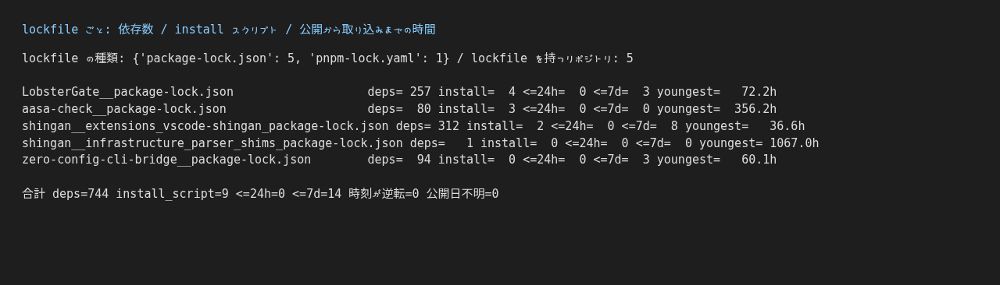
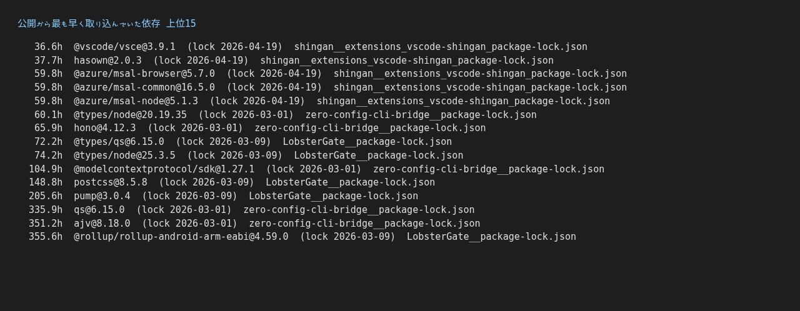
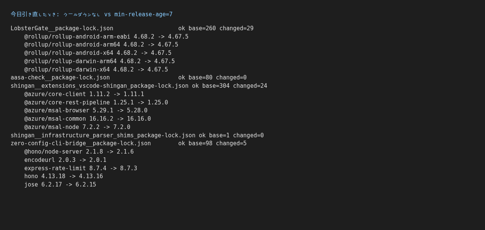
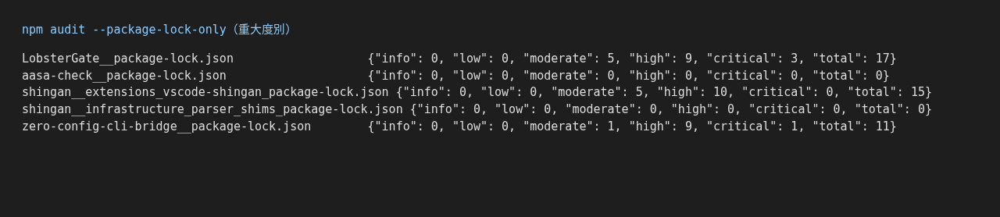
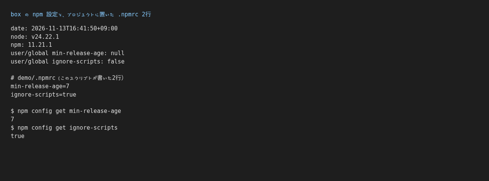

自分の公開リポジトリにある npm の依存744個について、「npm に公開されてから何時間後に、その版を lockfile に入れたか」を僕が数えてみました！（リポジトリ18個、lockfile 5件）
公開24時間以内に入れたものは0個でした。それでも7日以内は14個あって、いちばん早いのは公開から36.6時間後に lock していました（ログに出ている分の lock 日は2026年3〜4月で、今週の話ではありません）。
数えた Python スクリプト（依存なし）と、これから自分の npm プロジェクトに置く `.npmrc` の2行を最後に載せています。

趣味でSEをやっている hatyibei です。

## 1. なんで数えたのか

npm 11.10 から `min-release-age` という設定が入りました。「公開されてから○日たっていない版は入れない」（いわゆるクールダウン）ができます（[npm Docs: config](https://docs.npmjs.com/cli/v11/using-npm/config)、[Socket の解説](https://socket.dev/blog/npm-introduces-minimumreleaseage-and-bulk-oidc-configuration)）。
乗っ取られたパッケージから悪い版が出ても、数日のうちに見つかって消されることがあります。それなら少し待てば避けられるかもしれない、という考え方です。

で、思ったんですよね。
**「そもそも自分は、公開直後の版をどれくらい入れてるんだろう？」**
感覚では分からないので、数えることにしました。

## 2. やったこと

条件はこんな感じです。

- 実施: 2026-11-13 16:41〜16:43（JST）、所要71秒
- 環境: 検証に使った Linux マシン（以下 box）、node v24.22.1、npm 11.21.1
- 対象: `gh repo list hatyibei --source --no-archived --visibility public` で出てきた18リポジトリ
- clone は読み取り専用です。**リポジトリ内のスクリプトは実行していません**。`npm install` は `--package-lock-only --ignore-scripts` を付けたときだけで、ほかに使ったのは `npm audit --package-lock-only` と `npm config get` です（`npm ci` もパッケージの実行もしていません）。push もしていません
- API 費用: $0（検証に claude -p などの AI は使っていません）

数え方は1つだけです。

> その版が lockfile の git 履歴に**初めて現れたコミットの日時** − その版の npm **公開日時**

公開日時は registry.npmjs.org の `time` から取りました。

## 3. 結果① 公開から7日たたずに lock していたのは14個（24時間以内は0）

lockfile があったのは、18リポジトリのうち5リポジトリでした。内訳は package-lock.json が5ファイル（4リポジトリ）、pnpm-lock.yaml が1ファイル（1リポジトリ）です。pnpm のほうはファイルを数えただけで、中身は見ていません。

package-lock.json 5件の結果がこれです！



| lockfile | 依存 | installスクリプト | 24時間以内 | 7日以内 | いちばん早い |
|---|---:|---:|---:|---:|---:|
| LobsterGate | 257 | 4 | 0 | 3 | 72.2時間 |
| aasa-check | 80 | 3 | 0 | 0 | 356.2時間 |
| shingan/extensions/vscode-shingan | 312 | 2 | 0 | 8 | 36.6時間 |
| shingan/infrastructure/parser/shims | 1 | 0 | 0 | 0 | 1067.0時間 |
| zero-config-cli-bridge | 94 | 0 | 0 | 3 | 60.1時間 |
| **合計** | **744** | **9** | **0** | **14** | |

時刻が逆転したもの（公開より前に lock されている）も、公開日が取れなかったものも0でした。

**24時間以内が0なのは正直ホッとしました。**
でも7日以内は14個です。`min-release-age=7` を入れていれば、この14個はその時点では選ばれなかったはずです。ただ、これは仮定の話です。過去の時点に戻して試してはいませんし、lock 日も実際に解決した日時ではなくコミット日時で代わりにしています。

早かった順に並べたのがこれです。先に断っておくと、**このログは lockfile ごとに上位5件を拾ってから並べたもの**で、全体の上位15件ではありません。



```
   36.6h  @vscode/vsce@3.9.1  (lock 2026-04-19)  shingan__extensions_vscode-shingan_package-lock.json
   37.7h  hasown@2.0.3  (lock 2026-04-19)  shingan__extensions_vscode-shingan_package-lock.json
   59.8h  @azure/msal-browser@5.7.0  (lock 2026-04-19)  shingan__extensions_vscode-shingan_package-lock.json
   59.8h  @azure/msal-common@16.5.0  (lock 2026-04-19)  shingan__extensions_vscode-shingan_package-lock.json
   59.8h  @azure/msal-node@5.1.3  (lock 2026-04-19)  shingan__extensions_vscode-shingan_package-lock.json
   60.1h  @types/node@20.19.35  (lock 2026-03-01)  zero-config-cli-bridge__package-lock.json
   65.9h  hono@4.12.3  (lock 2026-03-01)  zero-config-cli-bridge__package-lock.json
   72.2h  @types/qs@6.15.0  (lock 2026-03-09)  LobsterGate__package-lock.json
   74.2h  @types/node@25.3.5  (lock 2026-03-09)  LobsterGate__package-lock.json
  104.9h  @modelcontextprotocol/sdk@1.27.1  (lock 2026-03-01)  zero-config-cli-bridge__package-lock.json
  148.8h  postcss@8.5.8  (lock 2026-03-09)  LobsterGate__package-lock.json
```

実際のログは15行で、ここに載せていない4行は168時間を超えています。なので7日以内として見えているのは11行です。
14個との差の3個は vscode-shingan の分です。vscode-shingan は7日以内が8個あるのに、上位5件しか拾っていないので3個がログに出ていません（7-2 でもう少し書きます）。

いちばん早かったのは VS Code 拡張の `@vscode/vsce@3.9.1` で、公開から36.6時間後に lock していました。
ログに出ている lock 日は 2026-04-19、2026-03-01、2026-03-09 です。**今週入ったものではありません。** 過去に lock した時点で、その版が出てから7日たっていなかった、という意味です。

## 4. 結果② min-release-age=7 で今日解決し直すと、lockfile 3件で延べ58個の版が変わった

次に、「クールダウンを入れたら実際どれくらい版が変わるの？」を見ました。

ここ大事なので先に書きます。**既存の lockfile を書き換えたわけではありません。**
package.json だけを空のディレクトリにコピーして、今日の時点で新しく解決し直しています。「クールダウンなし」と「`--min-release-age=7` あり」で1回ずつ解決して、差を取りました。

```bash
# クールダウンなし
npm install --package-lock-only --ignore-scripts --no-audit --no-fund
# 7日クールダウンあり
npm install --package-lock-only --ignore-scripts --no-audit --no-fund --min-release-age=7
```



```
LobsterGate__package-lock.json                   ok base=260 changed=29
    @rollup/rollup-android-arm-eabi 4.68.2 -> 4.67.5
    @rollup/rollup-android-arm64 4.68.2 -> 4.67.5
    ...
aasa-check__package-lock.json                    ok base=80 changed=0
shingan__extensions_vscode-shingan_package-lock.json ok base=304 changed=24
    @azure/msal-browser 5.29.1 -> 5.28.0
    @azure/msal-node 7.2.2 -> 7.2.0
    ...
shingan__infrastructure_parser_shims_package-lock.json ok base=1 changed=0
zero-config-cli-bridge__package-lock.json        ok base=98 changed=5
    hono 4.13.18 -> 4.13.16
    jose 6.2.17 -> 6.2.15
    ...
```

版が違ったのは 29 + 24 + 5 = **延べ58個**で、差が出たのは lockfile 5件中3件でした。
数え方は「両方の lock に同じパスがあって、版が違うもの」を lockfile の `packages` のパスごとに数えています。なので rollup のようなプラットフォーム別のパッケージは、それぞれ1個として数えています。リポジトリをまたいで同じパッケージが重なっていても、そのまま数えています。

見てて面白かったのは、ログに出ている例がどれも「ちょっと前の版に下がる」だけだったことです。
rollup が 4.68.2 → 4.67.5、hono が 4.13.18 → 4.13.16。58個を1つずつ全部見たわけではありませんが、ログに出ている例にはメジャーが変わるものはありませんでした。
「7日待つ」って聞くと重そうですが、ログの例を見る限りは、マイナーかパッチが1つ2つ前の版になるくらいの感覚でした！

## 5. ついでに npm audit（クールダウンとは別の話）

既存の lockfile に `npm audit --package-lock-only` もかけました。



lockfile ごとの total は、LobsterGate 17（うち critical 3）、vscode-shingan 15、zero-config-cli-bridge 11（うち critical 1）、aasa-check と shims は 0 でした。
lockfile をまたぐと同じ advisory が重なっているかもしれないので、足し算はしていません。

audit が見ているのは、既存の lockfile にある分かっている脆弱性です。クールダウンは新しく解決するときに効く設定なので、こことは別の話です。
こっちはこっちで直す必要があります。今回は数えただけで、まだ直していません。

## 6. 自分のプロジェクトに置く .npmrc 2行

box の素の設定を見たら、クールダウンも ignore-scripts もオフのままでした。



```
user/global min-release-age: null
user/global ignore-scripts: false
```

つまり、この box で何も書かずに `npm install` すると、クールダウンも ignore-scripts も効かない状態でした。ちょっと耳が痛い。

なので、これから自分の npm プロジェクトにはこの2行を置くつもりです。

```ini
min-release-age=7
ignore-scripts=true
```

デモ用のプロジェクトに書いて、そのディレクトリで効いているかだけ確かめました。

```
$ npm config get min-release-age
7
$ npm config get ignore-scripts
true
```

ただ、`ignore-scripts=true` で止まるのは install 時のスクリプトだけです。Sonatype の解説では、install スクリプトを使わず、パッケージが読み込まれたときに動くタイプのものが取り上げられています（[Sonatype: PolinRider campaign](https://www.sonatype.com/resources/videos/polinrider-campaign)）。なので「2行入れたから安心」ではないです。
今回の数字で言うと、install スクリプトを持つ依存は 9 個でした。

## 7. つまずいたこと

### 7-1. 依存数が2つの数え方で合わない

表の依存数と、引き直しのときの `base=` の数がずれています。

- LobsterGate: 257 と 260
- vscode-shingan: 312 と 304
- zero-config-cli-bridge: 94 と 98

lock_age.py は「パッケージ名＋版」の組で重複をまとめて、npm registry 以外から来たものは外しています。差分のほうは lockfile の `packages` のパスごとに数えていて、しかも base は今日新しく解決したものです。数え方も中身も違います。
なので**「744個のうち58個が変わった」とは言えません。** 書きかけて止めました。

### 7-2. 「上位15」のログは、全体の上位15ではなかった

集計スクリプトが lockfile ごとに上位5件だけを拾ってから並べていました。
3節のとおり、vscode-shingan は7日以内が8個あるのにログには5個しか出ていません。全部見たいときは、lockfile ごとの JSON（`rows`）を見る必要があります。

### 7-3. 「7日以内」を「今週入った」と読みそうになる

数字を見た瞬間「え、今週14個も！？」ってなったんですが、違いました笑
これは過去に lock した時点での若さです。ログに出ている lock 日は3月や4月でした。

## 8. 使えない場面

- **pnpm / yarn / bun**: 今回の lock_age.py は package-lock.json だけ対応です。pnpm-lock.yaml は1件見つかりましたが、数えただけで中身は見ていません
- **git 履歴が無い lockfile**: 「初めて現れたコミット日時」を lock した日として扱っています。履歴を消したリポジトリや、squash でまとめたリポジトリでは日時がずれます
- **npm 11.10 未満**: `min-release-age` が使えません。今回は npm 11.21.1 で試しました
- **既存 lockfile の扱い**: クールダウンは新しく解決するときに効く設定として試しました。既にある lockfile の版をさかのぼって下げるところは試していません

## 9. lock_age.py の使い方

依存なしの Python です。標準ライブラリと git だけで動きます。

```bash
mkdir -p cache
python3 -I lock_age.py <リポジトリのパス> <lockfileの相対パス> cache > age.json
# 例: python3 -I lock_age.py ./myrepo package-lock.json cache > age.json
```

- 第3引数はキャッシュ用のディレクトリです（registry から取った公開日時をパッケージごとに保存します）。自分で作っておいてください
- 出力は JSON で、`total`（依存数）、`install_script`、`within_24h`、`within_7d`、`rows`（早かった順）が入ります
- lockfile の git 履歴を全コミット分読むので、履歴が長いと少し時間がかかります。今回は18リポジトリぶんの clone から集計まで71秒でした

中身はこれで全部です。

```python
import json, os, subprocess, sys, time, urllib.parse, urllib.request
from datetime import datetime
repo, rel, cache = sys.argv[1], sys.argv[2], sys.argv[3]
REG = "https://registry.npmjs.org/"
def git(*a):
    return subprocess.run(["git", "-C", repo, *a], capture_output=True, text=True, check=True).stdout
def entries(lock):
    out = {}
    pk = lock.get("packages")
    if isinstance(pk, dict):
        for path, info in pk.items():
            if not path or info.get("link") or "version" not in info:
                continue
            res = info.get("resolved", "")
            if res and not res.startswith(REG):
                continue
            name = info.get("name") or path.rsplit("node_modules/", 1)[-1]
            out[(name, info["version"])] = out.get((name, info["version"]), False) or bool(info.get("hasInstallScript"))
        return out
    def walk(deps):
        for name, info in (deps or {}).items():
            res = info.get("resolved", "")
            if "version" in info and (not res or res.startswith(REG)):
                out.setdefault((name, info["version"]), False)   # v1 には hasInstallScript が無い
            walk(info.get("dependencies"))
    walk(lock.get("dependencies"))
    return out
def pub_times(name):
    f = os.path.join(cache, urllib.parse.quote(name, safe="") + ".json")
    if os.path.exists(f):
        return json.load(open(f))
    try:
        req = urllib.request.Request(REG + name.replace("/", "%2f"), headers={"Accept": "application/json"})
        with urllib.request.urlopen(req, timeout=60) as r:
            t = json.load(r).get("time", {})
    except Exception as e:
        t = {"_error": type(e).__name__}
    json.dump(t, open(f, "w")); time.sleep(0.05)
    return t
def p(s): return datetime.fromisoformat(s.replace("Z", "+00:00"))
first = {}
commits = [l for l in git("log", "--reverse", "--format=%H %cI", "--", rel).splitlines() if l]
for line in commits:
    sha, date = line.split(" ", 1)
    try:
        lock = json.loads(git("show", f"{sha}:{rel}"))
    except Exception:
        continue
    for key in entries(lock):
        first.setdefault(key, date)
cur_lock = json.load(open(os.path.join(repo, rel)))
cur = entries(cur_lock)
rows, missing = [], 0
for (name, ver), inst in sorted(cur.items()):
    pub = pub_times(name).get(ver)
    if not pub or (name, ver) not in first:
        missing += 1; continue
    age_h = (p(first[(name, ver)]) - p(pub)).total_seconds() / 3600
    rows.append({"name": name, "version": ver, "published": pub, "locked": first[(name, ver)],
                 "age_hours": round(age_h, 1), "install_script": inst})
rows.sort(key=lambda r: r["age_hours"])
print(json.dumps({
    "status": "ok", "lockfileVersion": cur_lock.get("lockfileVersion"), "commits": len(commits),
    "total": len(cur), "install_script": sum(cur.values()),
    "within_24h": sum(0 <= r["age_hours"] <= 24 for r in rows),
    "within_7d": sum(0 <= r["age_hours"] <= 168 for r in rows),
    "negative": sum(r["age_hours"] < 0 for r in rows), "missing": missing, "rows": rows}, ensure_ascii=False))
```

## まとめ

- 自分の依存744個のうち、公開から24時間以内に lock したものは0、7日以内は14個（過去に lock した時点の話で、今週入ったものではない）
- `min-release-age=7` を付けて今日 package.json から解決し直すと、lockfile 3件で延べ58個の版が変わった（ログに出た例はどれも少し前の版）
- audit は別の話。lockfile ごとに見ると、まだ直すものがある

「出たての版を入れているか」は、感覚より数えたほうが早かったです！
皆さんのリポジトリでも、一度 lock_age.py を回してみてください。何個出たか教えてもらえたらマジでうれしいです。

※スクショには個人情報やトークンが写っていないことを確認してから載せています。
