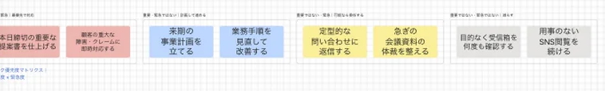
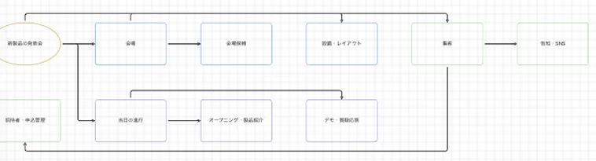
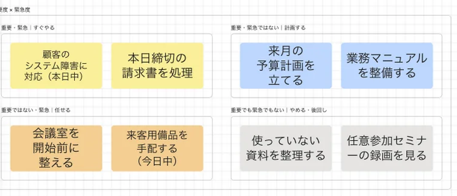
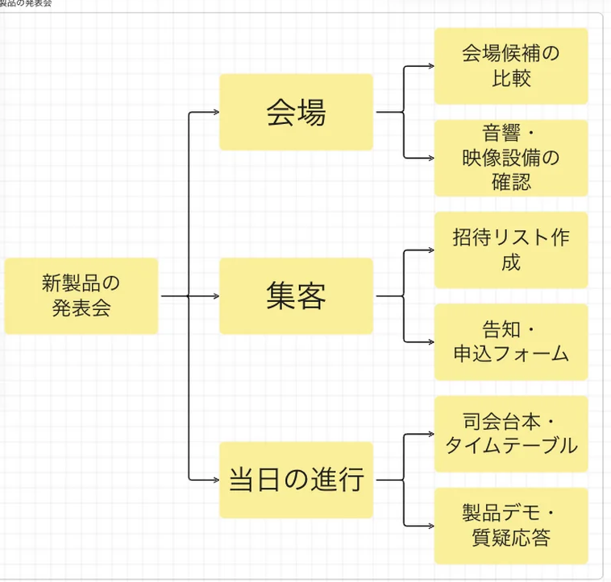

## マインドマップ 1 つに、書き込みが 18 回

AI にマインドマップを 1 つ頼みます。
すると AI は、付箋を 1 枚ずつ置く呼び出しを並べ、返ってきた ID を使って線を 1 本ずつ引きます。書き込みの呼び出しは 1 回の依頼で平均 18 回、かかる時間は 29 秒(中央値)。しかも 10 回頼んだうち 4 回は失敗しました。

人に置き換えると、付箋を 1 枚ずつ口頭で頼んでいる状態です。「これ貼って」「これも」「これも」「貼れた?じゃあ、さっきのとこれを線でつないで」。

メモにまとめて渡せばいいのに。

この記事のゴールは 2 つです。「メモで渡す」方式が向かないと言われている条件で、何を変えれば動くのか。そして、変えたら実際にどうなったのか。

こんにちは、株式会社 Kiva で FDE をやっている中堀です。
弊社の [Samurai App](https://samuraiax.com) には SIROE というホワイトボード(付箋・枠・矢印を置けるキャンバス)があり、チャットの AI がそこへ図を書けます。冒頭の数字は、その SIROE への書き込みを模擬のボードで測ったものです。測り方は後で書きます。

## 中間記法パターン(MNP)とは

「メモで渡す」方式には名前があります。なつさんが note で紹介している中間記法パターン(MNP)です。

https://note.com/art_reflection/n/nccfe6cc57073

定義はこうです。

> AIにGUIを操作させるのではなく、GUIと同等のデータを持てる内部処理用のDSLを設計し、それをAIに操作させる

部品は 4 つです。

- 記法(DSL)
- 記法を内部データへ変える parse
- 内部データを記法へ戻す serialize
- 記法の書き方を教えるシステムプロンプト

AI は今の状態を記法で読み、書き換えた記法を返します。アプリはそれを parse して描き直します。

## でも「向かない」って書いてある

元の記事は、MNP の限界もはっきり書いています。

- 状態が大きくなると、全量を渡せなくなる
- 既存プロダクトへの後付けは重い
- 大規模データ、複数人の同時編集、権限管理には向かない

SIROE は既存のプロダクトで、1 ページに 1,000 要素まで置けて、複数人が同時に編集して、AI の書き込みには人の承認を挟めます。

全部、当てはまります。

素直に読めば、ここで引き返すところです。

ただ、SIROE に当てはめて何が起きるかを書き出すと、困る所は 2 つに絞れました。ここからは元の記事ではなく、私たちの整理です。

1 つ目は、今の状態を全部渡すことです。SIROE の記法だと、1,000 要素で約 26,000 トークンになります。

2 つ目は、全文を書き直させることです。出力が要素の数に比例します。そのうえ、AI が読んだ後に人が追加した要素は、書き直した全文に入っていないので「消した」扱いになります。

それなら、全部は渡さず、全文も書き直させなければいい。
変えた行だけをメモに書いてもらう、という方針にしました。

つまり、この記事で作ったのは元の記事の方式そのままではありません。全文の書き直しをやめた変形です。

## 1 要素ずつ呼ぶと何が困るのか

先に、置き換える前の方式を整理しておきます。

AI は `add_element` / `update_element` / `delete_element` を 1 回に 1 要素ずつ呼んでいました。座標は省けて、省くとサーバが空いている場所に置きます。

困っていたことは 3 つです。

- 枠の中へ置きにくい。枠の所属は座標で決まるので、座標を省いた付箋は枠の外の空き場所に置かれます。枠の中へ置くにはモデルが座標を自分で計算することになり、外すことがあります
- 書き込みの呼び出しが要素の数だけ必要です。矢印は両端の ID が必要なので、要素を置いて ID を受け取ってから、もう 1 往復することになります
- 古い要素を読めません。読めるのは新しい方から 50 要素までです

口頭で 1 枚ずつ頼むと、こうなります。

## 記法の設計

では、メモの書式です。キャンバスは 1 行 1 要素の記法で読み書きします。

```
frame #3f9a2c@1 "よかったこと" gray
sticky #b81c0e@2 "一次回答が早くなった" yellow in #3f9a2c
connector #c7d1e2@1 #b81c0e -> #e9a0b1 "原因"
```

決めたことは 4 つです。

### どの要素のことか、どう伝える?

要素は `#<ID の先頭>@<バージョン>` で指します。ID の先頭はページの中で一意になる最短の長さ(6 文字から)です。

読むたびに `s1`, `s2` と連番を振る案もありました。
ただ、サーバが対応表を持たないかぎり、読んだ後に人が要素を追加すると、同じ名前が別の要素を指してしまいます。採用しませんでした。

ID の先頭なら、サーバが対応表を持たなくても要素を特定できます。

### 座標は書かせない

座標と大きさは書きません。位置の情報は枠の所属(`in`)と行の並びだけです。

モデルに座標を読ませると、書くときに座標を計算し始めます。
置き場所はサーバが決めます。`in` があれば枠の中の空いているマス、無ければ他と重ならない場所です。

### まだ無い要素に、どうやって線を引く?

矢印を引くには両端の ID が必要です。でも、これから作る要素にはまだ ID がありません。

そこで、新しい要素には `+名前` で名前を付けられるようにしました。同じ書き込みの中なら、矢印の端や `in` がその名前を指せます。

```
frame +f "論点"
sticky +a "申請が遅い" in +f
sticky +b "承認者が不在" in +f
+a -> +b "原因"
```

枠も付箋も矢印も 1 回の書き込みで作れます。

### 4 象限が 2 列に並ばない

ここまで作って測ったら、4 象限とマインドマップが失敗しました。
4 象限は 2 列に並ばず、マインドマップは孫が子より中心の近くに置かれます。


*4 象限を頼んだ結果。象限が横 1 列に並んでいる*


*マインドマップを頼んだ結果。中心からの階層が読み取れない*

座標を書かせない以上、形を伝えるキーワードが別に必要です。

そこで配置のキーワードを追加しました。新しい枠に `matrix` を添えると中を 2 行 2 列に、`tree` を添えると中を矢印に沿った木に並べます。

```
frame +m "優先度" matrix
frame +q1 "緊急・重要" in +m
sticky "障害対応" in +q1
```

同じ文で頼み直した結果です。生成し直しているので、付箋の文言は前の図と違います。


*`matrix` を追加した後の 4 象限*


*`tree` を追加した後のマインドマップ*

## 大規模データ・同時編集・権限管理への対処

### 1,000 要素あったらどうするの?

全部を毎回渡すことはしません。
読み込みは 1 つの枠だけ(`frame`)か、行の範囲(`offset` / `limit`)で進められるようにしました。

ただし、後で出てくる実測は 150 枚までです。その大きさだと、モデルはほぼ毎回 `limit: 1000` で全件を読みました。枠ごと・範囲ごとの読み込みが 1,000 要素でどう働くかは、まだ測っていません。

### AI が書いている間に、人が付箋を動かしたら?

AI は変えた行・足す行・消す行だけを送ります。メモには直す所だけを書く、ということです。

```
#b81c0e@2 red
- #c7d1e2@1
```

行のバージョンが今のバージョンと違えば、その行と、その行の `+名前` を指している行だけを拒否します。人が後から変更した要素を古い値で上書きしません。

残りの行は 1 回のトランザクションで適用します。1 つの要素が競合しただけで全部をやり直させることはしません。

### 承認カードが 6 枚出る

元の記事が挙げた権限管理のうち、SIROE のキャンバスで関係するのは AI の書き込みに対する人の承認です。誰が何を読み書きできるか、という権限そのものは、この変更では扱っていません。

Samurai App では AI の書き込みに人の承認を挟めます。1 要素ずつの方式では 6 枚の色を変えると承認カードも 6 枚出ていました。

記法では 1 回の書き込みに 1 枚で、カードには「付箋『…』をフレーム『…』の中に追加」のように行ごとの内訳を並べます。この説明文も同じ parser から作っています。


*付箋を 1 枚消して 2 枚足す依頼の承認カード。下の `notation` が AI の送った記法*

消す行を含む書き込みは削除と同じ扱いにして、承認を求めます。書き込みを「常に許可」にしていても、削除までは許可されません。

## で、実際どれくらい変わったの?

### 測り方

同じ依頼を 2 つの方式にかけました。

- **1 要素ずつ**: ツールの説明とヘルプを記法の前のものに差し替える
- **記法**: 今のもの

1 要素ずつの側は、変更前の本番そのものではなく再現です。ボードも手元で作った模擬データで、1 要素ずつ置く処理は簡略にしています。記法の parse / serialize と差分の計画は本番と同じ関数を通します。

成否は最後のボードで判定します(付箋が枠の中にあるか、矢印の向きと端が合っているか、など)。

測っていないものもあります。人が同時に編集する場面と承認は、この測定を通していません。バージョンの照合は単体テストで確かめています。

モデルは OpenRouter 経由の `openai/gpt-6-luna` で、各方式 10 回ずつです。費用は全部で $0.22 でした(入力の 91% はキャッシュから読んでいます)。

### 結果

往復・トークン・時間は 10 回の中央値(小さい方から 5 番目)、書き込みの呼び出しは 10 回の合計です。括弧の「拒否」は、失敗して返された呼び出しの数です。

| 依頼 | 方式 | 成功 | 往復 | 入力 tok | 出力 tok | 時間 (秒) | 書き込みの呼び出し |
| --- | --- | --- | --- | --- | --- | --- | --- |
| 作成(枠・付箋・矢印) | 1 要素ずつ | 5/10 | 10 | 82,549 | 2,240 | 24 | 56(拒否 6) |
| | 記法 | 10/10 | 5 | 40,397 | 552 | 7 | 10 |
| 一括変更(枠の 6 枚を緑) | 1 要素ずつ | 10/10 | 5 | 40,207 | 834 | 8 | 61(拒否 1) |
| | 記法 | 10/10 | 5 | 40,488 | 391 | 6 | 10 |
| 1 か所修正 | 1 要素ずつ | 10/10 | 5 | 39,730 | 366 | 6 | 13(拒否 3) |
| | 記法 | 10/10 | 5 | 40,544 | 331 | 6 | 12(拒否 2) |
| 大きなボード(150 枚)の整理 | 1 要素ずつ | 0/10 | 4 | 32,884 | 1,704 | 13 | 12 |
| | 記法 | 9/10 | 5 | 45,550 | 570 | 7 | 11 |
| 4 象限 | 1 要素ずつ | 4/10 | 6 | 49,813 | 2,268 | 16 | 87 |
| | 記法 | 10/10 | 5 | 40,251 | 755 | 7 | 10 |
| マインドマップ | 1 要素ずつ | 6/10 | 8 | 71,843 | 4,951 | 29 | 184(拒否 39) |
| | 記法 | 10/10 | 6 | 47,750 | 1,332 | 10 | 10 |

6 つの依頼を合わせると、記法は 59/60、1 要素ずつは 35/60 です。記法で送った 484 行のうち、拒否されたのは 1 行でした。

1 か所修正の記法の「12(拒否 2)」は、記法の行が拒否されたのではありません。12 回のうち 10 回は従来の `update_element` で、拒否の 2 回もそちらです。

### 図を作る依頼で、差が大きい

作成・4 象限・マインドマップでは、出力トークンが 3〜4 分の 1、時間が 2.3〜3.4 分の 1 です。

冒頭のマインドマップは、書き込みの呼び出しが平均 18 回から 1 回に、時間の中央値が 29 秒から 10 秒になりました。18 回には、拒否された 39 回分が入っています。

1 要素ずつの失敗の理由は、依頼ごとにこうでした。

- 作成(失敗 5 回): 矢印の向きか端が違う 4 回、付箋が枠の中に無い 1 回
- 4 象限(失敗 6 回): 象限の枠が 1 つも作られていない 6 回
- マインドマップ(失敗 4 回): 付箋が 1 枚しか置かれていない 2 回、孫が子より中心に近い 1 回、中心から線でたどれない付箋がある 1 回

この 3 つの依頼では、記法は 30 回すべて成功しました。

この差は、モデルの出来不出来だけではありません。1 要素ずつの方式では、枠の中へ置くのに座標の計算が要ります。方式が違うので、難しさも違います。

書き込みの回数も見てください。記法は 1 回の依頼でおおむね 1 回、1 要素ずつは平均 6〜18 回です。

### 150 枚のボードは 0/10

150 枚のうち「テスト」を含む 7 枚を枠にまとめる依頼です。

1 要素ずつは 10 回とも失敗しました。

新しい順の 50 件より外にある 4 枚が読めず、書かずに止まるか、4 枚を取り残します。記法で失敗した 1 回は 7 枚中 1 枚の取り残しでした。

## 待って、全部良くなったわけじゃない

ここまで読むと、記法にすれば全部良くなるように見えます。
表をもう一度見てください。そうなっていない行があります。

入力トークンが減るのは、往復が減る依頼だけです。入力は 1 往復あたり 8,000〜9,000 トークンで、往復の数にほぼ比例します。一括変更と 1 か所修正は往復が同じなので、入力も変わりません。大きなボードでは記法のほうが入力は多くなりました(45,550 対 32,884)。記法は 150 枚を全部読むうえ、1 要素ずつの側は書かずに止まった回が多く、往復が 1 回少ないためです。

1 か所の修正には差がありません。
しかも記法の方式でも、モデルは 10 回中 8 回、従来の `update_element` で直しました。付箋を 1 枚直すだけなら、口頭で頼めば済みます。

記法で書けるのは種別・テキスト・色・形・所属・矢印までです。傾きや書式は従来の操作で直すので、従来の操作は残しています。

測ったのは、モデル 1 つ、各 10 回、模擬のボードです。他のモデルや本番のボードで同じ差が出るかは確かめていません。

## まとめ

冒頭のゴールに戻ります。

「メモで渡す」方式が向かないと言われている条件で、何を変えれば動くのか。

- 全文を書き直させず、変えた行だけを送らせる
- 行ごとにバージョンを照合して、競合した行とそれを指す行だけを拒否する
- 座標は書かせず、枠の所属(`in`)と配置のキーワード(`matrix` / `tree`)で形を伝える

変えたら実際にどうなったのか。モデル 1 つ、各 10 回、模擬のボードで測った範囲では、こうでした。

- 図を作る依頼では、出力トークン・時間・成功率のすべてが良くなった
- 1 か所の修正では変わらなかった
- 同時編集と承認は設計と単体テストまでで、実モデルでは測っていない

まとめて頼むことはメモで、1 枚だけなら口頭で。人に頼むときと同じでした。

元の記事のおかげで、設計の出発点がはっきりしました。なつさん、ありがとうございます。
