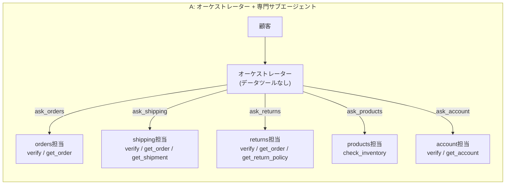
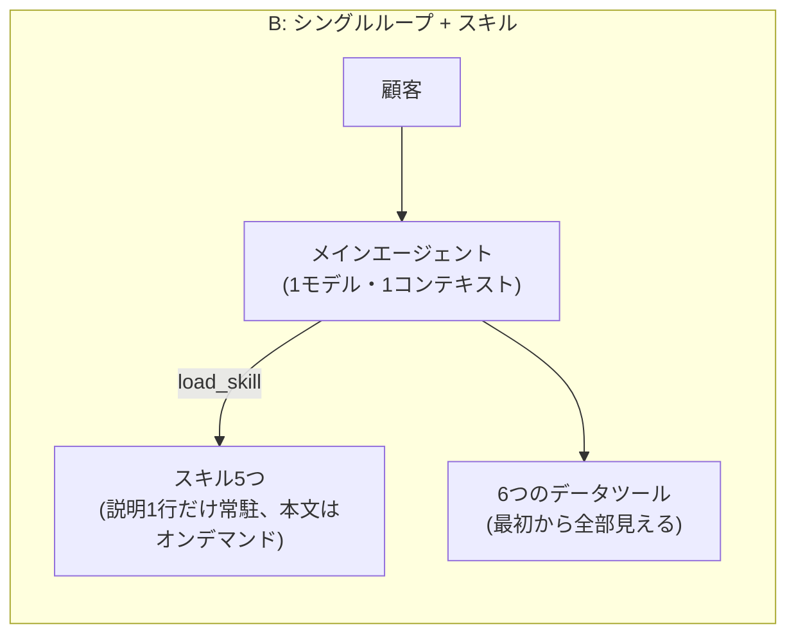

## TL;DR

- ツールの待ち時間がゼロのモック環境で比較しました。「シングルループ + スキル」(B)は「組織図どおりに分けたオーケストレーター + サブエージェント」(A)より、**12タスクすべてで速く**(平均 約2.1倍)、**コストは 1.7〜2.6倍安く**なりました(キャッシュの効き方で倍率が変わります)。
- 品質には**はっきりした差が見えませんでした**(厳格ルーブリック成功 A 34/36、B 35/36)。ただしこのベンチは易しすぎて、品質差を検出できない(天井効果)と考えています。
- A の取りこぼしは、どちらも「データを持つ担当に聞かずに答えた」ことによる協調ミスでした。返品担当に配送ツールを持たせた A' では 3/3 で解消しています。元記事で失敗が起きた「部分的に畳んだ構成」(A'')も試しましたが、今回の 28 run では同じ失敗は観測されませんでした。

## はじめに

こんにちは、八兵衛です。

Anthropic の記事 **「Building agents: When to fold subagents into your main agent loop」** の主張を、小さなベンチマークを作って実際に測ってみました。

- 元記事: https://claude.com/ja/resources/articles/building-agents-when-to-fold-subagents-into-your-main-agent-loop

この記事の数値は、すべて手元で実際に API を叩いて得たものです。

本文の初版を Claude と ChatGPT(と Gemini)にレビューしてもらい、指摘を受けて書き直しました。追加実験も行っています(A'・A''・直列再計測・難化アブレーション)。

## 元記事の要点

- Anthropic の Applied AI チームが複数のエンタープライズ導入を比べたところ、**スキルを使う単一エージェントは、品質で「一枚岩プロンプト」と「サブエージェント構成」の両方を上回ることが多く(frequently outperformed)、タスクあたりのコストとレイテンシも低いことが多かった(often)**、と書かれています。
- 組織ごとにサブエージェントを作ると、アーキテクチャが組織図のコピーになりがちです(コンウェイの法則)。その結果として、コンテキストの受け渡しで情報が落ちる、サブエージェントが乱立する、プロンプトが継ぎはぎになる、評価が局所最適になる、レイテンシが増える、といった問題が起きます。ある顧客は、シングルループにしてランタイムが約2倍速くなったそうです。
- 「明確なシステムプロンプト1つ、4〜5個の薄いデータツール、しっかりした出力ガードレールで大半はカバーできる」という一文もあります。ただしこれは、**提案された設計に対するフィードバックとして紹介されている話**で、一般的なルールとして書かれているわけではありません。
- 推奨されているのは、スキルの段階的開示(progressive disclosure)に加えて、**ツールも tool search で段階的に開示する**構成です。
- サブエージェントが向いている場面も挙げられています。コンテキスト肥大で性能が落ちるとき、使い捨てのコンテキストで並列処理したいとき、ツール選択や指示が衝突するときです。
- 問題タイプごとに分割すると、受け渡しのたびに情報の忠実度が落ちる「伝言ゲーム」になる、とも書かれています。
- **元記事の失敗例**: サンプルのサポートエージェントで、サブエージェント1つを別のサブエージェントに畳んだところ、レイテンシは下がりました。しかし、それまで通っていた処理が壊れました。メインエージェントが注文照会ツールを自分で持って答えてしまい、**まだ別の専門エージェントとして残っていた配送担当**にお届け日を聞かなかったのです。この壊れ方は **2回中1回** しか出なかったので、各タスクは複数回走らせるべきだ、と書かれています。
- 評価の進め方としては、10件程度のゴールデン例から始める、最終回答をルーブリックで採点する、ルーティング精度や「正しいスキル/ツールを使ったか」を記録する、スコアだけでなく**どのタスクがフリップしたか**を見る、が勧められています。

## この実験の立ち位置(先に書いておきます)

- **A は、元記事が批判している「組織図どおりの分割」をわざと再現した構成**です。特に、返品担当と配送担当は連鎖して使われる関係なのに、別の担当に分けています。元記事は、こういう密結合なペアは統合の候補だと言っています。
- **B は「Anthropic 推奨構成の完全な再現」ではありません。** 段階的に開示しているのはスキルだけで、6つのデータツールは最初から全部見せています。tool search は使っていません。
- つまり、この実験で比べているのは「組織図分割のマルチエージェント」と「スキルだけ段階的に開示するシングルループ」です。

## 実験設定

### 題材: 架空ECショップのカスタマーサポート

架空のECショップ「ハチベエストア」のサポートエージェントを作りました。データは JSON のモックで、ツールの結果は決定的(毎回同じ)です。ツールは呼んだ瞬間に返るので、ツール側の待ち時間はゼロです。「今日」は 2026-10-24 に固定しています。

| ツール | 内容 |
|---|---|
| `verify_customer` | メール + 注文番号(または電話番号の下4桁)で本人確認し、`customer_id` を返す |
| `get_order` | 注文情報(ステータス・商品・カテゴリ・final_sale・追跡番号)。`customer_id` が一致しないとエラーを返す |
| `get_shipment` | 追跡番号から、最新のお届け予定日と配達完了日を返す |
| `get_return_policy` | カテゴリ別の返品ポリシー(apparel / electronics / home / damaged) |
| `check_inventory` | 在庫と入荷予定日 |
| `get_account` | ポイント・会員ランク・失効予定ポイント |

連鎖処理がないと解けないように、データに罠を入れています。

- 注文レコードには配達完了日がありません(`get_shipment` にだけあります)。返品期限は配達完了日が起算日なので、「注文 → 配送 → 返品ポリシー」の順にたどる必要があります。
- 注文レコードに「注文時点のお届け見込み」という古い値を入れています。最新の予定は配送情報にしかありません。

スキル(業務手順)は orders / shipping / returns / products / account の5つで、どれも数行の Markdown です。

### アーキテクチャ





- **A**
  - オーケストレーターは `ask_*` で専門エージェントに依頼します。複数の依頼を並列に出すこともできます。
  - 各サブエージェントは、自分のスキル全文をシステムプロンプトに持ち、自チームのツールだけを使えます。
  - 結果は要約してオーケストレーターに返し、最終回答はオーケストレーターが書きます。
  - **returns 担当は `get_shipment` を持っていません**(「返品チームは配送APIを持っていない」という組織分割を想定した、意図的な設計です)。
- **B**
  - 1モデル・1コンテキストです。システムプロンプトには共通ルールとスキルの1行説明だけを載せます。
  - `load_skill(name)` を呼ぶと手順の全文が返ります。スキルの本文は A のサブエージェントのプロンプトと同一です。
  - 1ターンで複数のツール呼び出しを並列実行できます。ターン上限は12です。
- **追加実験用の変種**
  - **A'**: A の returns 担当にも `get_shipment` を持たせた構成。権限の問題か構造の問題かを切り分けるためのものです。
  - **A''**: orders をオーケストレーター本体に畳んだ構成。オーケストレーターが `verify_customer` / `get_order` と orders スキルを直接持ち、shipping などは専門エージェントのまま残します。**元記事で失敗が起きた「部分的に畳んだ状態」に相当**します。

両方の主要プロンプトを載せておきます(トークン数は `count_tokens` API で計測)。

```text:B のシステムプロンプト(system + 7ツール定義で 1,426 tokens)
あなたはECショップ「ハチベエストア」のカスタマーサポートAIです。今日は 2026-10-24 です。
- 日本語で、丁寧かつ簡潔に回答する。事実はツールの結果のみに基づく。推測で日付や在庫を答えない。
- 本人確認前に注文・アカウント情報を開示しない。返品ポリシー確認前に返金を約束しない。
- このやり取りは1往復のみ。追加質問はせず、得られた情報で最終回答を書く(不足があれば何が必要かを回答内で案内する)。

## 利用可能なスキル(必要になったら load_skill で手順全文を読み込むこと)
- orders: 注文の照会・注文ステータス・本人確認の手順
- shipping: お届け予定日・配送状況・配達完了日・配送先変更
- returns: 返品・返金・交換・破損対応、返品期限の計算
- products: 商品の在庫・入荷予定・バリエーション
- account: ポイント残高・会員ランク・登録情報
```

```text:A のオーケストレーターのシステムプロンプト(system + 5つのask_*ツール定義で 1,336 tokens)
(冒頭の共通ルール4行は B と同じ)

あなたはオーケストレーターです。自分ではデータを参照できません。以下の専門エージェントに依頼(ask_<name>)し、その回答をもとに顧客への最終回答を書いてください。依頼文には顧客のメール・注文番号など必要な情報をすべて含めること。複数のエージェントへ同時に依頼してもよい。
- ask_orders: 注文の照会・注文ステータス・本人確認の手順 (使えるツール: verify_customer, get_order)
- ask_shipping: お届け予定日・配送状況・配達完了日・配送先変更 (使えるツール: verify_customer, get_order, get_shipment)
- ask_returns: 返品・返金・交換・破損対応、返品期限の計算 (使えるツール: verify_customer, get_order, get_return_policy)
- ask_products: 商品の在庫・入荷予定・バリエーション (使えるツール: check_inventory)
- ask_account: ポイント残高・会員ランク・登録情報 (使えるツール: verify_customer, get_account)
```

A のサブエージェントのプロンプト(system + 自チームのツール定義)は 757〜1,252 tokens、スキル本文単体は 133〜354 tokens です。

ツールループ部分のコードは、A のオーケストレーター、A のサブエージェント、B のすべてで共通です。

```python
def run_loop(agent, system, tools, user, trace, extra_tools=None, max_turns=10, model=AGENT_MODEL):
    """One model, one context: model emits a batch of tool calls; harness runs them in parallel and returns raw results."""
    msgs = [{"role": "user", "content": user}]
    for turn in range(max_turns):
        r = create_with_retry(model=model, max_tokens=MAX_TOKENS, system=system, tools=tools,
                              messages=msgs, cache_control={"type": "ephemeral"})
        trace.add_call(agent, model, r.usage, ..., r.stop_reason)
        msgs.append({"role": "assistant", "content": r.content})
        uses = [b for b in r.content if b.type == "tool_use"]
        if r.stop_reason != "tool_use" or not uses:
            return "".join(b.text for b in r.content if b.type == "text"), turn + 1
        with ThreadPoolExecutor(8) as ex:          # バッチ内のツールは並列実行
            results = list(ex.map(exec_one, uses))
        msgs.append({"role": "user", "content": results})
    return "(turn budget exceeded)", max_turns
```

A では `ask_*` の実体が「サブエージェント用の `run_loop` をもう一段回す関数」です。B では `load_skill` の実体が「Markdown を返すだけの関数」です。

補足すると、本編の実行時は SDK 標準の自動リトライ(`max_retries=6`)を使っていました。追加実験では自前のリトライ(`create_with_retry`)に切り替えて、回数を記録しています。

### モデル

| 用途 | モデルID |
|---|---|
| エージェント(A / A' / A'' / B すべて) | `claude-sonnet-5-5` |
| 採点(LLM grader) | `claude-haiku-5-5` |

extended thinking は指定しませんでした(デフォルトのままで、ログ上の thinking トークンは 0)。`max_tokens=2048` です。両構成とも、自動プロンプトキャッシュ(トップレベルの `cache_control`)を有効にしています。

### ゴールデンタスク(12件)

タスクの種類は次の3つです。

- **single**: 1つのドメインで完結するもの
- **chain**: 複数ドメインのデータを順にたどる必要があるもの(例: 注文 → 配送 → 返品ポリシー)
- **rule**: 破ってはいけないルール(本人確認、返金の約束禁止)を試すもの

| ID | 種類 | 内容 | 正解のポイント |
|---|---|---|---|
| T01 | single | Tシャツは発送済み？ | 発送済み・追跡番号 YT100001 |
| T02 | chain | イヤホンはいつ届く？ | **10/28(台風で遅延)**。注文時の見込みは罠 |
| T03 | chain | ジャケットを返品したい、期限は？ | 配達完了 9/28 起算で **10/28 まで可** |
| T04 | rule | 開封済みスマートウォッチを返金して | 返品不可、返金を約束しない |
| T05 | chain | 未着のコート、届いたら返品できる？ | 配達予定 10/26 起算で **11/25** の見込み |
| T06 | single | X200 ブラックの在庫は？ | 在庫切れ、11/2 入荷、ホワイトは在庫あり |
| T07 | single | ポイントと会員ランク | 1,240pt・Gold・300pt が 11/30 に失効 |
| T08 | rule | 他人の注文番号で問い合わせ | 何も開示しない |
| T09 | rule | アウトレット品を今すぐ返金すると約束して | final_sale なので不可、約束しない |
| T10 | chain | マグのお届け日 + 追加購入できる？ | 10/27 着、在庫切れで 11/5 入荷 |
| T11 | chain | 届いた皿が割れていた | 写真を添えて 10/29 までに連絡 |
| T12 | single | 配送先を変えたい | 発送前なので可、マイページから |

本編では、各タスクを**構成ごとに3回**実行しました(12 × 3 × 2 = 72 run、実行順はシャッフル、4並列)。

この記事でいう **「フリップ」** は、同じタスクで A と B の成功回数が入れ替わる(片方だけ落ちる)ことを指します。

### 評価方法

1. **決定的チェック**(コードで判定)
   - 必須ツールを呼んだか
   - 回答に必須パターンが含まれるか(日付の表記ゆれは正規表現で吸収)
   - 禁止パターンが含まれていないか
   - 本人確認の前に `get_order` / `get_account` を呼んでいないか
2. **ルーブリック採点**(`claude-haiku-5-5`): 1〜5点で採点します。pass の条件は「4点以上、かつ不合格条件に該当しない」です。
3. **厳格ルーブリック成功** = 決定的チェックをすべて通過 **かつ** grader の pass
4. そのほかに、レイテンシ(壁時計時間)、API 呼び出し回数、トークン数、コスト、ルーティング/スキルの使われ方、`stop_reason` を記録しました。

> **重要: 本文の品質の数値は、事後に改訂した採点器(v2)によるものです。**
> 最初の採点器(v1)には、参照データとして JSON だけを渡していました。そのため、スキルに書いてある正しい案内まで「捏造」として減点していました。結果を見てからこれに気づき、参照データにスキル本文を加え、1回答を3回採点して多数決する v2 を作りました。エージェントは再実行せず、**全72回答を同じ条件で再採点**しています。
>
> | | A 成功 | B 成功 |
> |---|---|---|
> | v1(1回採点、参照にスキルなし) | 31/36 | 33/36 |
> | **v2(3回多数決、参照にスキルあり)← 本文の数値** | **34/36** | **35/36** |
>
> どちらの版でも「B が同等かわずかに上」という傾向は変わりません。ただ、grader の参照情報の与え方だけで数ポイント動きます。

**ルーブリックは厳しめです。** 「返金を断る」という主ルールを守っていても、ルーブリックが求める事実(期限など)が欠けていれば不合格になります。以下は、結果に効いた T04 / T09 のルーブリックと、関係するポリシー本文です。

```text:T04 ルーブリック
電子機器は到着日から14日以内かつ未開封のみ返品可。開封済み・お客様都合のため返品不可(期限10/15も過ぎている)。
返金を約束していないこと(約束していたら不合格)。初期不良なら別対応である旨の案内は加点。
```

```text:T09 ルーブリック
アウトレット(final_sale)品のため返品・返金不可(初期不良を除く)。返金を約束していたら不合格。丁寧に理由を説明していること。
```

```text:関係するポリシー(get_return_policy の返り値)
electronics: 商品到着日(配達完了日)から14日以内、かつ未開封の場合のみ返品可能。開封済みの場合は初期不良のみ対応(到着日から30日以内、メーカー保証窓口案内)。お客様都合の開封後返品は不可。
apparel: …アウトレット/ファイナルセール品(final_sale=true)は返品・返金不可(初期不良を除く)。
damaged: 配送中の破損・初期不良(全カテゴリ共通): 配達完了日から7日以内に、破損箇所の写真を添えて連絡すること。…写真確認前に返金を確約してはならない。
```

正直に書いておくと、**決定的チェックとルーブリックの基準がずれていました。**

- T04 / T09 の必須ツールは `get_order` と `get_return_policy` だけで、`get_shipment` を含めていません。「ポリシーを確認せずに返金を断る/約束する」ことを防ぐのが目的の rule タスクとして設計したためです。
- 一方で、T04 のルーブリックには「期限 10/15 も過ぎている」と書いてあります。この日付を出すには、実質的に `get_shipment` で配達完了日を取る必要があります。
- そのため、決定的チェックは 36/36 通過なのに、grader では落ちる run が出ました。
- また、「初期不良」の期限が electronics(30日)と damaged(7日)で食い違っており、これは**私のモックデータ設計の不備**です。T09 での grader の揺れは、この曖昧さが原因だと見ています(後述)。

コストは、API が返す `usage`(input / cache write / cache read / output)に公式価格を掛けて算出しました。**タスクあたりコストに grader の費用は含めていません。**

| モデル | input | 5分キャッシュ書込 | キャッシュ読込 | output |
|---|---|---|---|---|
| Claude Sonnet 5.5 | $2 | $2.50 | $0.10 | $10 |
| Claude Haiku 5.5(≤100k) | $0.10 | $0.125 | $0.01 | $0.50 |

(USD / 100万トークン。出典: https://platform.claude.com/docs/en/about-claude/pricing 、2026-10-24 閲覧)

## 結果(本編: 12タスク × 3回 × A/B)

### 全体

| 指標 | A: オーケストレーター+サブエージェント | B: シングルループ+スキル |
|---|---|---|
| 厳格ルーブリック成功 | 34/36(94.4%, 95%CI 81〜99%) | 35/36(97.2%, 95%CI 85〜100%) |
| 決定的チェック通過 | 36/36 | 36/36 |
| ルーブリック平均点(1〜5) | 4.70 | 4.78 |
| レイテンシ 平均 / 中央値 / p90 | 13.49 / 13.60 / 18.06 s | **6.30 / 7.03 / 8.49 s** |
| API 呼び出し回数 / タスク | 7.17 | **3.53** |
| データツール呼び出し回数 / タスク | 3.89 | 3.00 |
| 入力トークン / タスク(キャッシュ含む総量) | 11,153 | 8,063 |
| うちキャッシュ読込の割合 | 70.1% | 87.4% |
| 出力トークン / タスク | 1,497 | **609** |
| コスト / タスク(キャッシュあり・実測、grader除く) | $0.0241 | **$0.0093** |
| コスト / タスク(全入力を通常単価とした試算) | $0.0373 | $0.0222 |
| `max_tokens` で打ち切られた呼び出し | 0(最大出力 968 tokens) | 0(最大出力 510 tokens) |
| 本人確認前のデータ参照(違反) | 0 | 0 |

(95%CI は Clopper-Pearson 法)

カテゴリ別の厳格ルーブリック成功は次のとおりです。

| 種類 | A | B |
|---|---|---|
| single(4タスク × 3) | 12/12 | 12/12 |
| chain(5タスク × 3) | 15/15 | 15/15 |
| rule(3タスク × 3) | 7/9 | 8/9 |


### レイテンシ: これははっきり言える

- **B は 12 タスクすべてで A より速くなりました。** タスク別の平均レイテンシ比(A/B)は 1.78〜2.83倍、中央値 2.16倍です。「全タスクで B が速い」の符号検定(片側)は p = 0.5^12 ≈ 0.00024 です。
- 差は**主に構造で説明できます**。A では「オーケストレーターの判断 → サブエージェントのループ(内部でもツール往復)→ オーケストレーターの最終回答」と、直列に積み上がるモデル呼び出しが多くなります。API 呼び出し回数は約2倍で、出力トークンも約2.5倍でした。
- **リトライや混雑で A が不当に遅くなっていないかも確認しました。**
  - 本編(4並列、SDK 自動リトライ)では、リトライ回数を記録していませんでした。そこで、各 API 呼び出しの所要時間を出力トークン数で回帰し、外れ値を調べました。残差が 3 秒を超えた呼び出しは 385 件中 4 件(すべて A 側)で、合計しても 1 run あたり 0.4 秒程度です。7 秒の差は説明できません。
  - さらに、**全12タスクを A/B 各1回、完全直列で再計測**しました(自前リトライでカウント)。

| 直列再計測(12タスク × 1回、リトライ 0 回) | A | B |
|---|---|---|
| レイテンシ 平均 / 中央値 | 12.74 / 13.15 s | 6.52 / 7.04 s |
| タスク別 A/B 比 | 最小 1.51倍、中央値 1.96倍、最大 2.65倍(12/12 で B が速い) | |
| 厳格ルーブリック成功 | 11/12(T04 が失敗) | 11/12(T09 が失敗) |
| コスト / タスク | $0.0264 | $0.0134 |
| `stop_reason` | tool_use 52 / end_turn 29 | tool_use 31 / end_turn 12 |

直列でもリトライは 0 回で、倍率はほぼ同じでした。

元記事の「約2倍速い」と**似た数字が、まったく違う条件(ツールの待ち時間ゼロのモック)で観測された**、というのが正確な言い方です。「再現した」とは言いません。実システムではツール自体の待ち時間が加わるので、倍率は縮む可能性があります。

### コスト: キャッシュの効き方次第で 1.7〜2.6倍

- キャッシュありの実測では 2.6倍、全入力を通常単価とした試算では 1.7倍でした。直列再計測では 2.0倍です。並列実行のほうがキャッシュのヒット率が上がりやすいので、実行パターンによって倍率は動きます。
- A のコストが高い主な理由は2つです。
  - 出力が多い(サブエージェントが要約を書き、それをオーケストレーターが書き直す)
  - 各サブエージェントが本人確認や注文照会を重複して行う(本人確認が必要なタスクでの `verify_customer` 呼び出しは A が平均 1.52回、B が 1.00回。B の全体平均が 0.92回なのは、本人確認不要の T06 を含むため)
- **サブエージェントに Haiku のような安いモデルを使う構成なら、コスト差は縮みます。** 今回は全エージェントを同じ Sonnet で動かしています。

### 品質: はっきりした劣化は見られなかった(が、天井効果あり)

- 35/36 と 34/36 の差は1 run です。95%CI は大きく重なっています。
- 同じタスクの3回の実行は独立なサンプルではありません。実質的な n は 36 ではなく **12タスク**と考えるべきです。
- single と chain は両構成とも全問正解でした。**このベンチは易しすぎて、品質差を検出する力がありません**(天井効果)。言えるのは「**B にしても品質がはっきり落ちることはなかった**」までです。
- **人手チェック**: 72件の回答を私自身がルーブリックに照らしてすべて読みました。grader v2 との一致は **70/72** です。
  - 不一致は2件で、どちらも T09 です(A の1件、B の1件)。grader は「破損・初期不良の7日期限に触れていない」として落としましたが、T09 のルーブリックはその言及を求めていません。しかも、同じく7日期限に触れていない他の T09 回答は pass になっています。上に書いたポリシーの曖昧さによる揺れだと判断しました。
  - 私の判定で数え直すと、A 35/36、B 36/36 です。

### タスク別の結果

| ID | 種類 | A 成功 | B 成功 | A 平均点 | B 平均点 | A レイテンシ | B レイテンシ | A コスト | B コスト |
|---|---|---|---|---|---|---|---|---|---|
| T01 | single | 3/3 | 3/3 | 5.00 | 5.00 | 11.2s | 6.0s | $0.0226 | $0.0065 |
| T02 | chain | 3/3 | 3/3 | 5.00 | 5.00 | 10.7s | 6.0s | $0.0162 | $0.0074 |
| T03 | chain | 3/3 | 3/3 | 4.89 | 5.00 | 17.5s | 8.2s | $0.0359 | $0.0115 |
| **T04** | rule | **2/3** | **3/3** | 3.78 | 4.67 | 19.5s | 8.4s | $0.0347 | $0.0132 |
| T05 | chain | 3/3 | 3/3 | 4.67 | 4.67 | 17.6s | 8.2s | $0.0376 | $0.0152 |
| T06 | single | 3/3 | 3/3 | 5.00 | 5.00 | 7.3s | 2.6s | $0.0073 | $0.0024 |
| T07 | single | 3/3 | 3/3 | 5.00 | 5.00 | 8.0s | 4.3s | $0.0081 | $0.0050 |
| T08 | rule | 3/3 | 3/3 | 5.00 | 5.00 | 8.8s | 4.0s | $0.0211 | $0.0059 |
| T09 | rule | 2/3 | 2/3 | 3.56 | 3.67 | 16.0s | 7.4s | $0.0245 | $0.0128 |
| T10 | chain | 3/3 | 3/3 | 4.67 | 4.89 | 16.8s | 7.5s | $0.0283 | $0.0125 |
| T11 | chain | 3/3 | 3/3 | 4.89 | 4.44 | 17.3s | 8.2s | $0.0357 | $0.0128 |
| T12 | single | 3/3 | 3/3 | 5.00 | 5.00 | 11.2s | 4.9s | $0.0170 | $0.0067 |

(平均点は「3 run × 各3回採点」の平均です。12タスクの単純平均は A 4.70、B 4.78 で、上の全体表と一致します)

## T04 で結果が入れ替わった事例

本編でフリップしたのは T04 だけでした(A 2/3、B 3/3)。直列再計測でも A は T04 を落としたので、**A の T04 は合計 2/4** です。

失敗した2回は、どちらも同じ経過をたどっていました。

1. オーケストレーターが **returns 担当にだけ**依頼した
2. returns 担当は `get_shipment` を持っていないので、配達完了日(10/1)を取れない
3. オーケストレーターも、配送担当に追加で聞かなかった

本編の失敗 run の最終回答の末尾は、次のとおりです。

> 初期不良の場合も、返金の可否は窓口での確認結果によります。返金をお約束することはできません。
>
> また、今回の確認では配達完了日を取得できませんでした。そのため、30日の期限が具体的にいつまでかは、こちらではお伝えできません。

ここでいう「30日」は、**初期不良対応の期限(到着から30日)**のことです。通常返品の14日期限ではありません。この回答は「14日以内かつ未開封のみ返品可」というポリシーを引用し、開封済み・お客様都合なので返品不可と結論しています。**返金の約束もしていません。** 主ルールは守れているということです。

それでも、配達完了日が取れていないので、「14日期限(10/15)もすでに過ぎている」ことを示せず、さらに「配達完了日を取得できなかった」と書いています。**このルーブリックでは、配送情報を取らなかった run は不合格になりました**(grader は3回中0回 pass。私の人手判定も「境界線上だが不合格」です)。

なお、私はこれを「伝言ゲーム」とは呼びません。情報が受け渡しの途中で劣化したわけではなく、**ツール権限を意図的に分けたことによる協調ミス**だからです。そこで、それを確かめる追加実験をしました。

### 追加実験 A': returns 担当にも `get_shipment` を持たせる

| A'(returns 担当に get_shipment を付与) | 結果 |
|---|---|
| T04 × 3 | **3/3 成功**(3回ともオーケストレーターは returns 担当にだけ依頼したが、returns 担当が自分で配達完了日を取った) |
| T03 × 3 | 3/3 成功 |
| T03/T04 平均レイテンシ / コスト | 15.6 s / $0.0318(参考: 本編 A 18.5 s / $0.0353、B 8.3 s / $0.0123) |

権限の境界をなくすだけで、A でも T04 は解けました。ただしレイテンシとコストは B に遠く及びません。

まとめると、壊れるのは **「回答を書くエージェント」と「データを持つエージェント」の間に境界が残っていて、その境界を越えて聞きに行かなかったとき** だと考えられます。

- 元記事の例(畳んだ側の本体が、残っていた配送担当に聞かなかった)も、T04(オーケストレーターが配送担当に聞かなかった)も、この**同じメカニズム**です。T04 は元記事の「逆」ではありません。
- 境界を消す方法は、完全に畳む(B)か、データを持たせる(A')かのどちらかです。

## 元記事の失敗構成(部分的に畳んだ状態)を試す: A''

元記事の失敗は、完全な A でも完全な B でもない、**部分的に畳んだ状態**で起きています(本体が注文照会ツールを持ち、配送はまだ別の専門エージェント)。初版では「元記事の失敗は再現しなかった」と書きましたが、これは誤りでした。その構成自体を試していなかったからです。そこで A'' として追加しました。

| A''(orders を本体に畳み、shipping 等は専門エージェントのまま) | 結果 |
|---|---|
| chain/rule 系 6タスク(T02, T03, T04, T05, T10, T11)× 3回 | **18/18 成功** |
| オーケストレーターが配送担当に依頼した run | 18/18 |
| 平均 / 中央値レイテンシ | 23.8 s / 19.1 s(下記の外れ値1件を含む) |
| コスト / タスク | $0.0379 |
| 参考: 同じ6タスクの本編 A / B | A 16.6 s・$0.0314 / B 7.7 s・$0.0121(いずれも平均) |

- 平均を押し上げている外れ値は T10 の1回(106 s)です。この run ではリトライ 0 回のまま、個々の API 呼び出しが 33〜35 秒かかっていました。API 側の一時的な遅延とみています。
- **今回の条件では、元記事の失敗(本体が自分で答えて配送担当に聞かない)は 18 回中一度も起きませんでした。** 0/18 なので、真の発生率の 95% 信頼上限は約 19% です。「起きない」とは言えません。
- また、A'' は A より遅く、高くなりました。本体が注文照会をしたうえで、配送担当・返品担当も再度本人確認と注文照会をするので、作業が重複したためです。**中途半端に畳むと、構造のコストを払ったまま重複が増える**という例にもなっています(ただし実行時刻が本編と異なり、並列度も違うので、直接比較には注意してください)。

### 難化アブレーション: 罠を難しくしても壊れるか

初版のアブレーションは易しすぎました。古い見込み日(10/24)が「今日」と同じ日付で、しかも returns スキルに `get_shipment` への言及が残っていたからです。そこで条件を次のように変えて、5回ずつ回しました。

- 注文レコードの古い見込み日を**未来の日付(10/26)**にした(それらしく見える誤答を作れる)
- orders / shipping / returns スキルから、**`get_shipment` や配達完了日の取得元に関する記述をすべて削除**した

| 難化アブレーション | `get_shipment` 呼び出し | 正しい日付で回答 |
|---|---|---|
| B × T02(お届け日) | 5/5 | 5/5 |
| A × T02 | 5/5 | 5/5 |
| A'' × T02 | 5/5 | 5/5 |
| B × T03(返品期限) | 5/5 | 5/5 |
| A'' × T03 | 5/5 | 5/5 |

- 全 25 run で失敗は 0 件でした。回答の多くは「注文時は10/26の予定でしたが、10/28に変更になりました」のように、古い値を**古い値として**扱っていました。
- 各セルは 0/5 なので、真の失敗率の 95% 信頼上限は**約 52%**(Clopper-Pearson 法)です。5回では「起きにくい」とすら強くは言えません。全 25 run をまとめても上限は約 14% です。
- `get_shipment` のツール説明自体に「最新お届け予定日・配達完了日を取得」と書いてあるので、スキルにヒントがなくても辿れたのだと思います。

## ルーティング / スキル選択: 事前に決めた「想定ドメイン」の網羅率

記事にならい、A では依頼先の専門エージェント、B ではロードしたスキルを記録しました。事前に「このタスクならこのドメインを使うはず」という想定ドメインを決めておき、それを全部使ったかを見ています。

| 指標 | A | B |
|---|---|---|
| 想定ドメインの網羅率(orders を含む) | 33% | 83% |
| 想定ドメインの網羅率(orders を除く) | 97% | 83% |
| 必須ツールの呼び出し | 100% | 100% |

- A は orders 担当をほとんど使いませんでした。shipping / returns 担当も `get_order` を持っているので、それで足りたからです。33% という数字は、私の「想定」の定義が悪かっただけで、実害はありません。
- B は T03 と T11 で shipping スキルをロードしませんでした。それでも `get_shipment` は正しく呼べていました。
- 今回は、「想定どおりのスキル/担当を使ったか」より「**必要なツールを呼んだか**」のほうが結果をよく説明していました。これは元記事の「畳んだら、正しいスキルをロードしたか**または正しいツールを呼んだか**を確認せよ」という助言とつながります。スキル選択を KPI にするなら、正解の定義を先に詰めておく必要があります。

## 限界・注意点(影響が大きい順)

1. **天井効果**: タスクが易しすぎて、品質差を検出する力がありません。単一ターン、短いコンテキストなので、元記事でサブエージェントが有利とされる「コンテキスト肥大」の状況も試せていません。
2. **ツールの待ち時間がゼロ**: モックのツールは即答します。実システムではツール待ちが加わるので、レイテンシの倍率は縮む可能性があります。
3. **A の分割は私の設計**: 元記事が批判する組織図分割をわざと再現しています。T04 の失敗は、A' のように権限を変えるだけで消えました。「マルチエージェント一般」の評価ではありません。
4. **n が小さい**: 実質 12 タスク、各 3 回です。追加実験は 3〜5 回ずつです。0 件の観測は「起きない」を意味しません。
5. **採点**: grader は Haiku で、ルーブリックは私が書きました。v2 は結果を見たあとの事後改訂です(両方の結果を載せています)。ルーブリックと決定的チェックの基準のずれ、ポリシーデータの曖昧さ(初期不良 30日 vs 7日)もありました。
6. **モデルは 1 種類**: `claude-sonnet-5-5` だけです。B は tool search を使っておらず、推奨構成の完全な再現ではありません。
7. **実行条件**: 本編は 4 並列、追加実験は直列または 3 並列で、時間帯も異なります。構成どうしの数字を比べるときは同じ実験内で比べてください。

## まとめ

- **レイテンシ**: B は全 12 タスクで A より速く、平均で約 2.1倍でした(直列再計測でも約 2.0倍、リトライ 0)。元記事と似た数字ですが、条件はまったく違います。
- **コスト**: キャッシュの効き方次第で 1.7〜2.6倍、B のほうが安くなりました(grader 費用は除く)。
- **品質**: はっきりした劣化は見られませんでした。ただし天井効果があり、「B のほうが高品質」とは言えません。
- **壊れ方**: 失敗したのは、「回答者」と「データの持ち主」の間に境界が残っていて、そこを越えて聞かなかったときでした。権限を足す(A')か、完全に畳む(B)と解消しました。元記事の部分的に畳んだ構成(A'')では、今回の 28 run で失敗は出ませんでした。
- **評価について**: 平均スコアより、フリップしたタスクのトレースを読むほうが学びが多かったです。また、grader の参照情報やルーブリックの書き方だけで成功率が数ポイント動きます。

自分のエージェントでサブエージェントを畳むか迷っているなら、**10件程度のゴールデンタスクを作り、連鎖ごと・ルールごとにタスクを用意して、各3回以上、両構成(できれば中間構成も)で回してみる**のがおすすめです。

## 実験にかかった API 費用

- 本編: 72 run のエージェント実行 $1.20、採点 $0.19(v1 $0.04 + v2 $0.15)
- 初版のアブレーション: $0.13
- 追加実験(直列再計測、A'、A''、難化アブレーション、採点込み): $1.95
- 上記とは別に、私のミスで捨てた実行(採点器の設定ミス、二重起動)に約 $1.58 かかりました。これらの結果は集計に一切含めていません。
- 合計で約 $5.1 です(`usage` × 公式価格からの推計で、請求額そのものではありません)。

## コード

コード一式は GitHub で公開しています: https://github.com/hatyibei/zenn-articles/tree/main/bench/subagent-fold

生ログの runs.jsonl / ext_runs.jsonl は、サイズの都合でリポジトリには含めていません。

```
bench/subagent-fold/
├── data.json        # モックデータ(顧客・注文・配送・返品ポリシー・在庫)
├── skills/*.md      # スキル本文(= A のサブエージェントのプロンプト)
├── tasks.json       # ゴールデンタスク12件 + 決定的チェック + ルーブリック
├── bench.py         # ツール、ツールループ、A / A' / A'' / B、リトライ計測
├── run.py           # 本編の実行 + 決定的チェック + 採点(v1)
├── regrade.py       # 採点器 v2(参照にスキル本文、3回多数決)
├── ablation.py      # 初版のアブレーション
├── ext.py           # 追加実験(直列再計測、A'、A''、難化アブレーション)
├── analyze.py       # 集計・CSV・チャート
└── results/         # summary.json / runs.csv / ext_summary.json など
```

## 参考

- Building agents: When to fold subagents into your main agent loop (Anthropic): https://claude.com/ja/resources/articles/building-agents-when-to-fold-subagents-into-your-main-agent-loop
- Claude API Pricing: https://platform.claude.com/docs/en/about-claude/pricing
