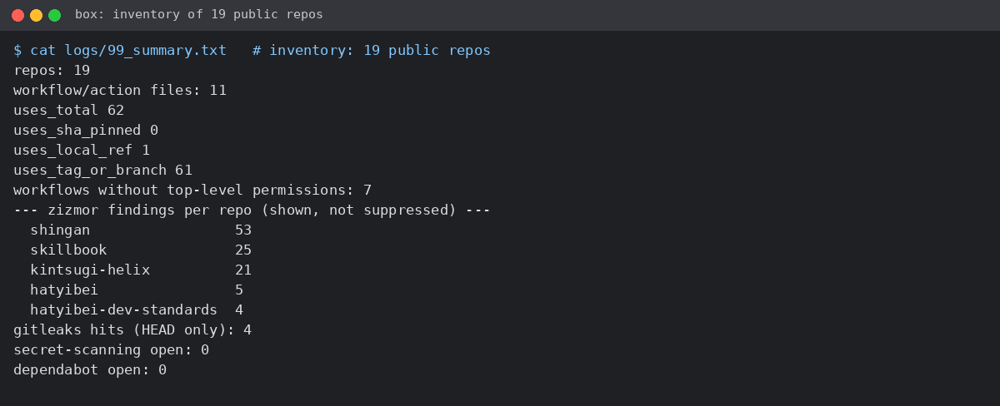
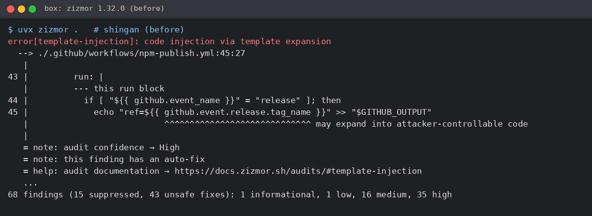
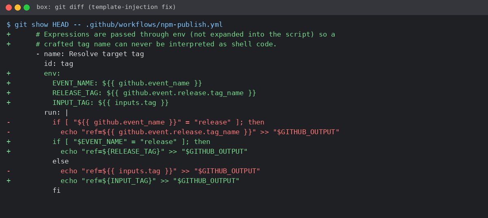
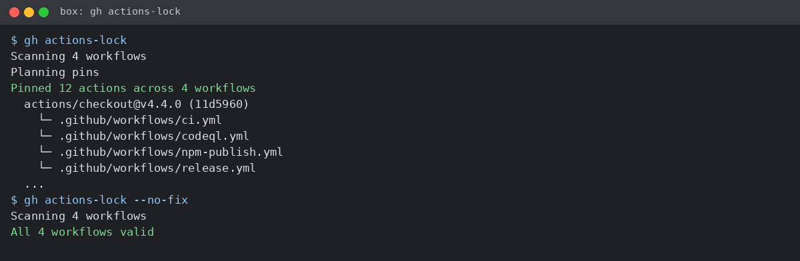
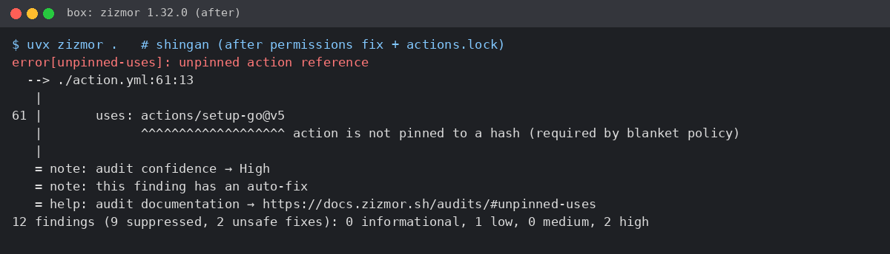

自分の公開リポジトリ19個の GitHub Actions を zizmor で点検したら、指摘が108件。一番多かった自作ツール shingan の53件を、3件まで減らしました。
意外だったのは、actions.lock を入れても、リポジトリ直下の `action.yml` だけは固定されずに残ったことです。
持ち帰れるのは、読み取り専用の点検スクリプト（末尾に全文）と、53件を3件にした PR の中身です。


こんにちは、八兵衛です。

GitHub Actions の workflow lockfile（actions.lock）が [10/28 に GA](https://github.blog/changelog/2026-10-28-github-actions-workflow-lockfiles-are-generally-available) になったので、「lock を入れても消えない指摘は何件か」を自分のリポジトリで数えてみました。

手順と修正は Claude Code CLI に設計・下書きさせ、僕は box（作業用の Linux 環境）での実行、差分のレビュー、push とマージをやりました。CLI は Bash なしで設計したので、zizmor の JSON の項目名は自分で「未確認」と書いていました。叩いたらちゃんと集計できて結果オーライでしたが、AI の手順は「未確認」のところから確かめるのがよさそうです。

サムネ以外の画像5枚は box のターミナル出力です。個人情報やトークンは入っていません（hatyibei は公開しているハンドルです）。

## 0. そもそも SHA 固定と actions.lock って？

`@v4` のようなタグは、あとから別のコミットに付け替えられます。なので zizmor は、コミット SHA で固定していない `uses:` を unpinned-uses（High）として出します。

actions.lock は、使う action ごとにバージョンとコミット SHA を書き留めるファイルです。今回できたファイルにも `actions/checkout@v4.4.0` に `commit: 'sha1-11d5960…'` のように記録されていました。

## 1. 19リポジトリを46秒で棚卸し：指摘108件、SHA 固定は0

公開リポジトリを全部 shallow clone して、[zizmor](https://docs.zizmor.sh/usage/) 1.32.0、actionlint 1.7.12、gitleaks 8.30.1（`--redact` で値を伏せる）、`gh api` を流しました。actionlint と gitleaks は公式リリースのチェックサムを確かめてから使っています。点検ツールで変なものを踏んだらシャレにならないので！

10:01 に流し始めて、46秒で終わりました。



| 項目 | 結果 |
|---|---|
| ワークフロー / action ファイル | 11本（あるのは19個中5リポジトリ） |
| `uses:` | 62個（SHA 固定 0、同じリポジトリ内を指すもの 1、タグ・ブランチ指定 61） |
| トップレベルに `permissions:` がないワークフロー | 7本 |
| zizmor の指摘（表示分） | 108件（shingan 53、skillbook 25、kintsugi-helix 21、hatyibei 5、hatyibei-dev-standards 4） |
| actionlint | 1件（kintsugi-helix の `codecov/codecov-action@v3` のランナーが古い） |
| gitleaks（HEAD のみ） | 4件。例示キーやテスト用 JWT などで、本物はなし |
| Dependabot / secret scanning | Dependabot は全リポジトリで無効、secret scanning は1個で無効（5 で書きます） |
| GITHUB_TOKEN の既定権限 | 17個が read、2個が write（ワークフローが PR を承認できる設定も ON） |

一番多かったのは shingan の53件。秘密検出のルールまで持っているツールが、Actions の指摘数ではぶっちぎりの1位です。紺屋の白袴ってこういうことなんですね笑

## 2. shingan の53件：半分以上はタグ指定だった

shingan は自分で作って npm に公開しているツールなので、今回はここだけ直しました。



最終行は「68 findings (15 suppressed, …)」。zizmor が非表示にした15件を除いた53件の内訳はこうです。

- unpinned-uses 29件（High）: action をタグで指定している
- artipacked 9件: checkout が認証情報を残したままにする
- excessive-permissions 6件（Medium）＋2件（High）: 権限が広すぎる
- template-injection 2件（High）＋1件（Info）
- cache-poisoning 2件（High）
- secrets-inherit 1件、self-repository 1件

各指摘の意味は [Audits のページ](https://docs.zizmor.sh/audits/) にまとまっています。件数が出たら、まずここを開くのがおすすめです。

29件はタグ指定なので actions.lock で片づく……はずでした（1件だけ片づかなかった話は 4 で）。残り24件は自分で直す分です。

## 3. 権限などを直して53→31件、actions.lock で31→3件（PR #63）

修正は Claude Code CLI に書かせ、僕がレビューして push。[PR #63](https://github.com/hatyibei/shingan/pull/63) で10:12 にマージしました。

| 指摘 | 直し方 |
|---|---|
| excessive-permissions | 先頭を `contents: read` にし、書き込みはジョブ単位（goreleaser は `contents: write`、npm 公開は `id-token: write`、GHCR への push は `packages: write`、CodeQL は `security-events: write`） |
| artipacked | 全 checkout に `persist-credentials: false`（push するジョブはない） |
| template-injection | `run:` に直接書いていた `${{ github.event.release.tag_name }}` などを `env:` 経由に |
| secrets-inherit | `secrets: inherit` をやめて `NPM_TOKEN` だけを渡す |
| cache-poisoning | リリースビルドの setup-go を `cache: false` に（遅くなるだけ） |
| unpinned-uses | `gh actions-lock` で actions.lock を作った |

template-injection だけ補足です。`run:` に `${{ }}` で値を直接埋め込むと、その値はシェルスクリプトの一部として展開されます。環境変数に入れて `"$TAG"` で参照すれば、ただの文字列として扱われます。



ここまでで31件。残りは unpinned-uses 29件、cache-poisoning 1件、self-repository 1件です。そこで [gh actions-lock](https://github.com/github/gh-actions-lock) を実行しました。



「Pinned 12 actions across 4 workflows」と出て、`.github/workflows/actions.lock`（87行）ができました。`--no-fix` で確かめると「All 4 workflows valid」。

ワークフローの `uses:` も `@v4` から `@v4.4.0` に書き換わります。ただ `@v4.4.0` 自体はタグのままで、SHA が記録されているのは actions.lock の側です。タグを細かくしただけでは固定になりません。

そして指摘は31件から一気に3件に！ unpinned-uses は29件→1件です。zizmor が lock をどう見て判定しているのかは確かめていません。



最終行は「12 findings (9 suppressed, …): 0 informational, 1 low, 0 medium, 2 high」。actionlint は修正前と同じく0件のままでした。

## 4. actions.lock でも残った3件（action.yml は lock の外）

ここが今回いちばん持ち帰ってほしいところです。

1. **直下の `action.yml` の unpinned-uses**: composite action の中の `uses: actions/setup-go@v5` が固定されていません。今回の gh actions-lock は `.github/workflows/` の4本だけが対象で、`action.yml` は入りませんでした。
2. **npm 公開ジョブの setup-node の cache-poisoning**: `cache` を指定しなければキャッシュしないはず、と判断して触っていません（未確認）。
3. **self-repository（Low）**: reusable workflow を `./.github/workflows/npm-publish.yml` のようなローカルパスで呼んでいる箇所に、自リポジトリ参照用の専用構文を勧める指摘です。リリースの流れが変わるので見送りました。

1 は影響の向きにも注意です。`action.yml` は shingan 自身の CI ではなく、`uses: hatyibei/shingan@…` で使う人のワークフローの中で動きます。タグのままだと効いてくるのは利用者の側です。

この setup-go はまだ直していません（PR #63 では同じファイルの go-version を上げただけ）。直すなら `action.yml` の中に SHA を直接書くことになりそうです。

錠前を12個かけても、玄関の `action.yml` だけは開けっぱなしでした。

## 5. つまずいたこと

### push が workflow スコープで弾かれた

actions.lock を足したブランチを push したら、拒否されました。

```
refusing to allow an OAuth App to create or update workflow `.github/workflows/actions.lock` without `workflow` scope
```

gh のログイントークンに `workflow` スコープがなかったのが原因です。lock ファイルもワークフロー扱いなんですね。workflow 権限のある別のトークンで push し直しました。

### PR の CI で govulncheck が落ちた

原因は僕の修正ではなく、Go 標準ライブラリ（net/http）の新しい脆弱性 [GO-2026-6859](https://pkg.go.dev/vuln/GO-2026-6859)。go1.26.10 で検出、go1.26.11 で修正です。main の最後の CI（11/5）は通っていたので、そのあとに出たものでした。

go.mod の toolchain と、ワークフロー・`action.yml` の go-version を 1.26.11 に上げ、lint / test / govulncheck / build / test-langgraph / CodeQL が全部通ってからマージ。セキュリティの PR が別のセキュリティの理由で止まる。地味にありそうです！

### 「open アラート 0件」は、実は機能がオフだった

01 の画像のサマリーには、secret scanning と Dependabot の open アラートが「0」と出ています。でもログを見たら、Dependabot は19個すべてで「disabled」（403）、secret scanning も1個で「disabled」（404）が返っていて、そのエラー応答を0件と数えていました。「0件」と「見ていない」は正反対なので要注意です。

## 6. 使えない場面・限界

- **履歴は見ていない**: HEAD だけです。過去のコミットに残ったシークレットは見ていません（gitleaks の git モードは未実施）。
- **リリース系の変更は未検証**: release.yml と npm-publish.yml の変更は、次にタグを打つまで動きません。
- **件数は表示分だけ**: 非表示（suppressed）の分は数えていません。
- **直したのは shingan だけ**: 他の4リポジトリ、既定権限が write の2個、shingan の `action.yml` の setup-go はまだです。
- **npm の長期トークンはそのまま**: [trusted publishing](https://docs.npmjs.com/trusted-publishers) への移行は npm 側の登録が要るので、今回はやっていません。
- **GitHub Enterprise Server では gh actions-lock は対象外**（help に記載）。

## 7. 点検スクリプト repo-checkup.sh

今日の手順を、どのアカウントでも使えるようにまとめました。[hatyibei-dev-standards に置いてあります](https://github.com/hatyibei/hatyibei-dev-standards/blob/main/scripts/repo-checkup.sh)。

```bash
bash repo-checkup.sh <OWNER>
```

GitHub 側には何も書き込まず、書くのは出力先ディレクトリ（clone とログ）だけです。actionlint・gitleaks・gh actions-lock は、入っていれば使います。

注意が1つ。`uvx zizmor` は版を指定していないので、実行のたびにその時点の zizmor を取ってきます（今日のログにも `Downloading zizmor` が残っていました）。冒頭コメントの「ダウンロードしない」は uvx 以外の話です。固定したいなら `uvx zizmor@1.32.0` のように書くのがよさそうです（置いてあるファイルはまだ直していません）。

10:14 に hatyibei で実行したら、29秒で summary.txt が出ました。別作業でリポジトリが1個増えて20個に。zizmor の指摘は計58件で、shingan はちゃんと3件に減っていました！

これから毎月、金曜の定期点検で回す予定です。

:::details repo-checkup.sh（全文）

```bash
#!/usr/bin/env bash
# repo-checkup.sh — 自分の公開リポジトリの GitHub Actions / シークレット周りを毎月点検する
#
# 使い方: ./repo-checkup.sh OWNER [OUTDIR]     (OUTDIR 省略時は ./checkup-YYYYMMDD)
#
# 前提（このスクリプトはダウンロードもインストールもしない）:
#   必須: gh（gh auth login 済み）, git, jq, uv（uvx zizmor を使う）
#   任意: actionlint, gitleaks（PATH にあれば使う）, gh 拡張 actions-lock（入っていれば使う）
#   GH_TOKEN が未設定なら gh auth token から設定する（値は表示しない）。
#
# 読み取りのみ。GitHub 側の設定やリポジトリには一切書き込まない。
# 書くのは OUTDIR 以下（shallow clone とログ）だけ。見るのは各リポジトリの HEAD のみで、履歴は見ない。
set -uo pipefail

usage() { echo "usage: $0 OWNER [OUTDIR]" >&2; exit 2; }
[ $# -ge 1 ] && [ -n "$1" ] || usage
OWNER=$1
OUT=${2:-./checkup-$(date +%Y%m%d)}
LOG=$OUT/logs; WORK=$OUT/work

# ===== 0. 前提チェック =====
for c in gh git jq uv; do
  command -v "$c" >/dev/null 2>&1 || { echo "error: $c が見つかりません" >&2; exit 1; }
done
gh auth status >/dev/null 2>&1 || { echo "error: gh にログインしていません（gh auth login）" >&2; exit 1; }
if [ -z "${GH_TOKEN:-}" ]; then
  GH_TOKEN="$(gh auth token 2>/dev/null)" || { echo "error: gh auth token に失敗" >&2; exit 1; }
  export GH_TOKEN                                     # 値は表示しない
fi
HAVE_ACTIONLINT=0; command -v actionlint >/dev/null 2>&1 && HAVE_ACTIONLINT=1
HAVE_GITLEAKS=0;   command -v gitleaks   >/dev/null 2>&1 && HAVE_GITLEAKS=1
HAVE_LOCK=0;       gh extension list 2>/dev/null | grep -q 'actions-lock' && HAVE_LOCK=1

mkdir -p "$LOG" "$WORK" || exit 1
date -Iseconds > "$LOG/00_started_at.txt"
{ gh --version | head -1; git --version; uv --version; jq --version; uvx zizmor --version
  [ $HAVE_ACTIONLINT = 1 ] && actionlint -version | head -1 || echo "actionlint: skipped (not in PATH)"
  [ $HAVE_GITLEAKS = 1 ] && echo "gitleaks $(gitleaks version)" || echo "gitleaks: skipped (not in PATH)"
  [ $HAVE_LOCK = 1 ] && echo "gh actions-lock: installed" || echo "gh actions-lock: skipped (not installed)"
} > "$LOG/00_versions.txt" 2>&1
echo "== tools =="; cat "$LOG/00_versions.txt"

# ===== 1. 公開リポジトリ一覧 =====
gh repo list "$OWNER" --visibility public --limit 1000 \
  --json name,isFork,isArchived,pushedAt > "$LOG/01_repos.json" \
  || { echo "error: $OWNER のリポジトリ一覧を取得できません" >&2; exit 1; }
REPOS=$(jq -r '.[].name' "$LOG/01_repos.json")
echo "repos: $(jq length "$LOG/01_repos.json")"

# ===== 2. shallow clone（HEAD のみ） =====
: > "$LOG/02_clone_failed.txt"
for r in $REPOS; do
  [ -d "$WORK/$r" ] || git clone --depth 1 --quiet "https://github.com/$OWNER/$r.git" "$WORK/$r" \
    || echo "$r" >> "$LOG/02_clone_failed.txt"
done
has_wf() { compgen -G "$1/.github/workflows/*.y*ml" >/dev/null || [ -f "$1/action.yml" ] || [ -f "$1/action.yaml" ]; }

# ===== 3. zizmor（0=指摘なし, 11〜14=指摘あり, それ以外=失敗） =====
echo "== zizmor =="
: > "$LOG/03_zizmor_exit.txt"; : > "$LOG/03_zizmor_failed.txt"
for r in $REPOS; do d=$WORK/$r; [ -d "$d" ] && has_wf "$d" || continue
  uvx zizmor --format=json "$d" > "$LOG/03_zizmor_$r.json" 2> "$LOG/03_zizmor_$r.stderr"; ec=$?
  echo "$r exit=$ec" >> "$LOG/03_zizmor_exit.txt"
  case $ec in 0|11|12|13|14) ;; *) echo "$r exit=$ec" >> "$LOG/03_zizmor_failed.txt" ;; esac
done
for f in "$LOG"/03_zizmor_*.json; do [ -s "$f" ] || continue
  r=${f##*/03_zizmor_}; r=${r%.json}
  jq -r --arg r "$r" '.[] | [$r, .ident, .determinations.severity] | @tsv' "$f" 2>/dev/null
done > "$LOG/03_zizmor_findings.tsv"
cut -f1 "$LOG/03_zizmor_findings.tsv" | sort | uniq -c | sort -rn > "$LOG/03_zizmor_by_repo.txt"
cut -f2,3 "$LOG/03_zizmor_findings.tsv" | sort | uniq -c | sort -rn > "$LOG/03_zizmor_by_rule.txt"

# ===== 4. actionlint =====
: > "$LOG/04_actionlint_exit.txt"
if [ $HAVE_ACTIONLINT = 1 ]; then echo "== actionlint =="
  for r in $REPOS; do d=$WORK/$r; [ -d "$d/.github/workflows" ] || continue
    ( cd "$d" && actionlint -oneline ) > "$LOG/04_actionlint_$r.txt" 2>&1
    echo "$r exit=$?" >> "$LOG/04_actionlint_exit.txt"   # 0=なし, 1=指摘あり, それ以外=失敗
  done
else echo "actionlint: skipped (not in PATH)"; fi

# ===== 5. gitleaks（HEAD のみ、--redact で値を伏せる） =====
: > "$LOG/05_gitleaks_summary.tsv"; echo 0 > "$LOG/05_unredacted_count.txt"
if [ $HAVE_GITLEAKS = 1 ]; then echo "== gitleaks =="
  for r in $REPOS; do d=$WORK/$r; [ -d "$d" ] || continue
    gitleaks dir "$d" --redact --no-banner --exit-code 0 -f json -r "$LOG/05_gitleaks_$r.json" \
      2>> "$LOG/05_gitleaks_stderr.txt"
  done
  cat "$LOG"/05_gitleaks_*.json 2>/dev/null | jq -s '[.[][] | select(.Secret != "REDACTED")] | length' \
    > "$LOG/05_unredacted_count.txt"                     # 0 以外なら該当 JSON をすぐ削除すること
  for f in "$LOG"/05_gitleaks_*.json; do [ -s "$f" ] || continue
    r=${f##*/05_gitleaks_}; r=${r%.json}
    jq -r --arg r "$r" '.[] | [$r, .RuleID, .File, (.StartLine|tostring)] | @tsv' "$f"
  done > "$LOG/05_gitleaks_summary.tsv"                  # ルール名・ファイル・行だけ
else echo "gitleaks: skipped (not in PATH)"; fi

# ===== 6. gh actions-lock --no-fix（ファイルは書き換えない） =====
if [ $HAVE_LOCK = 1 ]; then echo "== gh actions-lock --no-fix =="
  for r in $REPOS; do d=$WORK/$r; [ -d "$d/.github/workflows" ] || continue
    ( cd "$d" && gh actions-lock --no-fix ) > "$LOG/06_actions_lock_$r.txt" 2>&1
  done
else echo "gh actions-lock: skipped (not installed)"; fi

# ===== 7. GITHUB_TOKEN の既定権限（読み取りのみ） =====
echo "== default GITHUB_TOKEN permissions =="
for r in $REPOS; do
  printf '%s\t' "$r"
  gh api "repos/$OWNER/$r/actions/permissions/workflow" \
    --jq '[.default_workflow_permissions, .can_approve_pull_request_reviews] | @tsv' 2>/dev/null \
    || echo "unavailable"
done > "$LOG/07_default_token_perms.tsv"

# ===== 8. summary =====
{
  echo "owner: $OWNER   date: $(date -Iseconds)"
  echo "public repos: $(jq length "$LOG/01_repos.json")   clone failed: $(wc -l < "$LOG/02_clone_failed.txt")"
  echo "--- zizmor: findings $(wc -l < "$LOG/03_zizmor_findings.tsv"), failed runs $(wc -l < "$LOG/03_zizmor_failed.txt") ---"
  echo "[by repo]";            cat "$LOG/03_zizmor_by_repo.txt"
  echo "[by rule / severity]"; cat "$LOG/03_zizmor_by_rule.txt"
  if [ $HAVE_ACTIONLINT = 1 ]; then
    echo "--- actionlint: repos with findings $(grep -cv 'exit=0$' "$LOG/04_actionlint_exit.txt") ---"
    grep -v 'exit=0$' "$LOG/04_actionlint_exit.txt"
  else echo "--- actionlint: skipped (not in PATH) ---"; fi
  if [ $HAVE_GITLEAKS = 1 ]; then
    echo "--- gitleaks (HEAD only): hits $(wc -l < "$LOG/05_gitleaks_summary.tsv"), unredacted $(cat "$LOG/05_unredacted_count.txt") ---"
    cut -f1,2 "$LOG/05_gitleaks_summary.tsv" | sort | uniq -c | sort -rn
  else echo "--- gitleaks: skipped (not in PATH) ---"; fi
  [ $HAVE_LOCK = 1 ] && echo "--- gh actions-lock: see logs/06_actions_lock_*.txt ---" \
    || echo "--- gh actions-lock: skipped (not installed) ---"
  echo "--- default GITHUB_TOKEN permissions (repo / default / can_approve_pr) ---"
  awk -F'\t' '{print $2}' "$LOG/07_default_token_perms.tsv" | sort | uniq -c
  grep -P '\twrite\t|\ttrue$' "$LOG/07_default_token_perms.tsv"
  echo "elapsed_sec: $SECONDS"
} > "$OUT/summary.txt"
echo; cat "$OUT/summary.txt"
```

:::

## まとめ

- 19リポジトリを46秒で棚卸ししたら、zizmor の指摘は108件。`uses:` 62個のうち SHA 固定は0個でした。
- shingan は権限などを直して53件→31件、actions.lock で31件→3件。でも直下の `action.yml` は lock に入らず残りました。

actions.lock を入れた（入れる予定の）リポジトリの直下に `action.yml` があるなら、その中の `uses:` がタグのままになっていないかだけ見てみてください。

回してみて「うちはこう直した」があれば、コメントで教えてもらえるとうれしいです！
